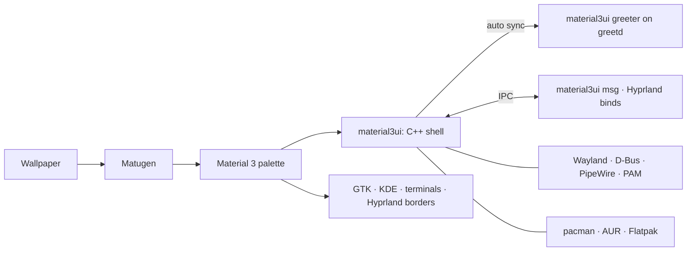

<p align="center">
  
</p>

<h1 align="center">Material3UI</h1>

<p align="center">
  <b>One design language, from the login screen to the package manager.</b><br/>
  A Material 3 desktop shell for Hyprland, written in C++ for Wayland.
</p>

<p align="center">
  <a href="#screenshots">Screenshots</a> ·
  <a href="#install-in-one-line">Install</a> ·
  <a href="#a-tour">Tour</a> ·
  <a href="#make-it-yours">Customise</a> ·
  <a href="#faq">FAQ</a> ·
  <a href="https://github.com/Abijspy/material3-android-shell/releases/latest">Releases</a> ·
  <a href="CHANGELOG.md">Changelog</a>
</p>

<p align="center">
  
  
  
  
</p>

<p align="center">
  
</p>

---

Most Linux desktops are a patchwork. The bar comes from one project, the lock screen from another, the login screen from a third, and updates run in a terminal. Each has its own fonts, colours and idea of what a button looks like.

**Material3UI replaces the patchwork with one shell.** Your wallpaper sets the colours. The same palette, shapes and motion carry through the bar, dock, panels, notifications, lock screen, login screen, password prompts and update manager, and out into GTK, KDE and terminal apps.

**v4 is native.** The shell is one C++ program that talks to Wayland, D-Bus, PipeWire and PAM directly. It renders every pixel itself with OpenGL ES and leaves the blur to the compositor. Qt, QML and Quickshell are gone.

## Screenshots

<table>
  <tr>
    <td></td>
    <td></td>
  </tr>
  <tr>
    <td align="center"><b>Desktop:</b> the bar, its dynamic island and the dock</td>
    <td align="center"><b>Dashboard:</b> calendar, weather, media and system</td>
  </tr>
  <tr>
    <td></td>
    <td></td>
  </tr>
  <tr>
    <td align="center"><b>Launcher:</b> apps, maths, emoji, clipboard, files</td>
    <td align="center"><b>Wallpapers:</b> ten ship with the shell</td>
  </tr>
  <tr>
    <td colspan="2"></td>
  </tr>
  <tr>
    <td colspan="2" align="center"><b>Settings:</b> one app for the whole desktop</td>
  </tr>
</table>

## Install in one line

You need an Arch-based system (Arch, CachyOS, EndeavourOS, ...) with Hyprland 0.55 or newer.

```bash
bash -c "$(curl -fsSL https://raw.githubusercontent.com/Abijspy/material3-android-shell/main/install.sh)"
```

The installer asks a few questions, shows you one plan (packages, the shell build, every config it will write) and only then runs, with backups and a `restore.sh` for everything it replaces. To preview it, clone the repo and run `./install.sh --dry-run`.

<details>
<summary><b>Installer options</b></summary>

| Flag | What it does |
| :--- | :--- |
| `--dry-run` | Show every package and file it would touch, and change nothing (from a local checkout) |
| `--yes` | Accept all defaults, for scripted or repeat installs |
| `--hypr full` · `inject` · `skip` | `full` installs the whole Hyprland config. `inject` adds the shell to your existing config. `skip` leaves Hyprland alone. |
| `--terminal` · `--file-manager` · `--browser` | Your apps. The defaults are Alacritty, Nemo and LibreWolf. |
| `--greeter` | Also install the greetd login screen (asks for sudo) |
| `--channel latest` · `release` | Follow `main` (default), or the latest tagged release |
| `--skip-deps` | Don't install packages; only build the shell and deploy the configs |
| `--restore [stamp]` | Put back the configs an install replaced (the last one by default) |
| `--uninstall` | Remove the shell from `/usr`; configs stay |

The full walkthrough from a fresh system is in the [install guide](docs/INSTALL.md). Coming from KDE or GNOME? Read the [migration guide](docs/MIGRATION.md).

</details>

## A tour

From the moment the machine boots:

**1 · Log in.** The login screen runs on greetd and is the lock screen's twin: the same clock, widgets, weather, password pill and motion. Pick a user and a session, or suspend and shut down from there. When you change your wallpaper or avatar, the login screen picks it up automatically. → [Login screen](docs/GREETER.md)

**2 · The desktop.** The bar is yours to arrange: drop widgets (weather, date, media, CPU, notifications, clipboard, screenshot and more) into its left, centre and right, or right-click it to edit it in place. Its centre holds a dynamic island. It grows to show the song that's playing, a workspace switch or an incoming notification, then shrinks back. The bar and panels are translucent with the compositor's blur behind them. A dock on the bottom edge keeps your pinned and running apps, and slides away until you need it.

**3 · Tap <kbd>Super</kbd>.** Spotlight opens. It finds apps, files and commands, does maths, and has an emoji picker. <kbd>Super</kbd><kbd>V</kbd> opens the clipboard history, images included.

**4 · Open the panels.**
- **Quick Settings:** volume, brightness, Wi-Fi, Bluetooth, Do Not Disturb, Caffeine, night light, and the connected network's live download and upload speed.
- **Notification Centre** and **Dashboard:** notifications, the clock, a calendar and the week's weather.
- **Overview:** every workspace at a glance.

**5 · Change the wallpaper.** Ten wallpapers ship with the shell, eight of them drawn from Material 3 Expressive shapes (<kbd>Ctrl</kbd><kbd>Super</kbd><kbd>T</kbd>). Pick one or your own image and Matugen builds a new Material 3 palette from it, or seed the palette from an accent colour you choose. The whole desktop recolours, GTK, KDE, Alacritty, kitty and Hyprland's window borders included.

**6 · Lock the screen.** <kbd>Super</kbd><kbd>L</kbd> shows a clock and the widgets you picked: date, weather, forecast, media, battery and a notification count. Rearrange it on a grid in the full-screen lock screen editor (Settings → Lock screen).

**7 · Something asks for your password.** The prompt comes from the shell's own polkit agent, so it looks like the rest of the desktop and not like a 2009 dialog box.

**8 · Updates arrive.** A status bar icon shows how many are pending.
- **Left-click** opens Packages & Updates, with official repo, AUR and Flatpak updates in one list.
- **Middle-click** runs the upgrade in your terminal.
- The **Repo**, **AUR** and **Flatpak** tabs search each source and install with one click.

→ [Packages & Updates](docs/PACKAGES.md)

**9 · Something feels slow.** <kbd>Ctrl</kbd><kbd>Alt</kbd><kbd>Del</kbd> opens the system monitor: CPU, memory, disks and processes, read straight from `/proc`.

**10 · Grab part of the screen.** <kbd>Super</kbd><kbd>G</kbd> opens the screenshot tool, which captures a region, a window or the whole screen, with a delay. Shots are copied to the clipboard and can open in an editor. <kbd>Super</kbd><kbd>Shift</kbd><kbd>S</kbd> grabs a region straight away. <kbd>Super</kbd><kbd>Shift</kbd><kbd>X</kbd> copies the text in a region (OCR), and <kbd>Super</kbd><kbd>Shift</kbd><kbd>R</kbd> starts or stops a screen recording.

## Keys worth learning

| | Open | | Do |
| :--- | :--- | :--- | :--- |
| <kbd>Super</kbd> tap | Spotlight | <kbd>Super</kbd><kbd>Return</kbd> | Terminal |
| <kbd>Super</kbd><kbd>Space</kbd> | App launcher | <kbd>Super</kbd><kbd>E</kbd> | File manager |
| <kbd>Super</kbd><kbd>N</kbd> | Quick Settings | <kbd>Super</kbd><kbd>B</kbd> | Browser |
| <kbd>Super</kbd><kbd>A</kbd> | Notifications | <kbd>Super</kbd><kbd>V</kbd> | Clipboard history |
| <kbd>Super</kbd><kbd>D</kbd> | Dashboard | <kbd>Super</kbd><kbd>.</kbd> | Emoji |
| <kbd>Super</kbd><kbd>Tab</kbd> | Switch windows (hold Super) | <kbd>Super</kbd><kbd>Shift</kbd><kbd>S</kbd> | Screenshot a region |
| <kbd>Super</kbd><kbd>G</kbd> | Screenshot tool | <kbd>Super</kbd><kbd>Shift</kbd><kbd>X</kbd> | Copy text from screen (OCR) |
| <kbd>Super</kbd><kbd>I</kbd> | Settings | <kbd>Super</kbd><kbd>Shift</kbd><kbd>R</kbd> | Record a region |
| <kbd>Ctrl</kbd><kbd>Super</kbd><kbd>T</kbd> | Wallpapers | <kbd>Super</kbd><kbd>L</kbd> | Lock |
| <kbd>Ctrl</kbd><kbd>Alt</kbd><kbd>Del</kbd> | System monitor | <kbd>Super</kbd><kbd>Esc</kbd> | Power menu |
| <kbd>Super</kbd><kbd>`</kbd> | Overview | | |

Window and workspace binds (<kbd>Super</kbd><kbd>1…0</kbd>, <kbd>Super</kbd><kbd>Q</kbd>, <kbd>Super</kbd><kbd>F</kbd>, ...) are in [`keybinds.lua`](dotfiles/.config/hypr/material3ui/keybinds.lua). To change any of them, use **Settings → Keybinds** (see below).

## Make it yours

Most settings live in the built-in **Settings** app (<kbd>Super</kbd><kbd>I</kbd>, or the gear in Quick Settings). It has pages for:
- **Network:** Wi-Fi, with the connection's details and live speeds.
- **Devices and sound:** Bluetooth, sound (with left/right balance), and display.
- **Look:** wallpaper and colour, and Look & feel: blur, transparency, corner roundness and animation speed.
- **Bar and dock:** the status bar (position, and a widget editor for its left, centre and right) and the dock.
- **Lock screen and weather:** the clock and widgets on the lock and login screens; your location, units and forecast.
- **Tools:** clipboard and screenshots.
- **Session:** notifications, and lock & idle.
- **Packages & Updates, and About.**

**Hyprland Settings** is its companion app for the compositor itself: a window of its own (Hyprland Settings in the launcher, `material3ui msg hyprsettings`, or the button at the foot of either app's sidebar). Every change applies live, is saved at once, undoes with <kbd>Ctrl</kbd><kbd>Z</kbd> and resets per option to what your config files had. It has:
- **Every Hyprland option** (all of them, read from the running Hyprland, so new ones appear on their own): windows and borders, decoration, layouts, input devices, gestures, cursor, groups, behaviour, rendering and debug, with Hyprland's config errors on top.
- **Displays:** drag monitors into place; resolution, refresh rate, scale, rotation, VRR, 10-bit colour, HDR and mirroring. Anything that could leave the screen unusable reverts by itself unless you keep it.
- **Animations:** every animation's length, curve and style, and a curve editor with presets and a live preview.
- **Keybinds:** press a shortcut to set it; binds for any action or command, and mouse drags.
- **Rules:** window, layer and workspace rules, picked from the windows and layers on screen.
- **Startup apps and environment variables.**
- **Cursor themes, plugins** (hyprpm, with a catalogue to download and install) **and profiles** (whole setups saved by name; `material3ui msg hypr profile next` switches from a keybind).

Its changes live in `hyprland_custom.lua`, applied after the rest of your config. → [Hyprland Settings](docs/HYPRLAND.md#hyprland-settings)

For everything else, here is which file to edit. Updates never overwrite the files marked ✎.

| I want to... | Edit |
| :--- | :--- |
| Use a different terminal, browser or file manager | ✎ `~/.config/hypr/material3ui/apps.lua` |
| Remap, disable or add keybinds | **Hyprland Settings → Keybinds** (saved to ✎ `keybinds_custom.lua`) |
| Change any Hyprland option, monitor, animation or rule | **Hyprland Settings** (saved to `hyprland_custom.lua`) |
| Rearrange the bar | **Settings → Status bar → Widgets**, or right-click the bar |
| Change the lock screen | **Settings → Lock screen → Open editor** (the login screen follows) |
| Set the weather location | **Settings → Weather** |
| Pin apps to the dock | **Settings → Dock**, or right-click an app in the dock |
| Write my own Lua for rules, monitors or autostart | ✎ `~/.config/hypr/material3ui/user.lua` |
| Understand the Hyprland setup | [docs/HYPRLAND.md](docs/HYPRLAND.md) |
| Script the shell from a terminal or another program | `material3ui msg` (below) |

### Drive it from the terminal

Every panel and action is a command on the shell's IPC socket, sent with `material3ui msg`:

```bash
material3ui msg popup dashboard              # toggle a panel
material3ui msg settings dock                # open Settings on a page
material3ui msg wallpaper set ~/sunset.jpg   # apply a wallpaper; "next" cycles
material3ui msg screenshot region            # or window, screen, ocr
material3ui msg volume set 40
material3ui msg lock
```

`material3ui msg help` lists every command, and the [IPC reference](docs/IPC.md) documents them.

## Safe by default

A desktop shell touches a lot of your system, so the installer and updater are built to be predictable:

- **Nothing is overwritten silently.** Every replaced file is copied to `~/.config/material3ui/backups/<timestamp>/` first.
- **Everything is logged** to `~/.cache/material3ui/install-*.log`.
- **You review before it runs.** It lists missing packages (found with `pacman -T`) and every file it will write, and waits for your confirmation.
- **Updates keep your changes.** `./update.sh` rebuilds the shell and preserves `apps.lua`, `user.lua`, your keybind edits and your colours, and remembers which Hyprland mode you chose.
- **Upgrades stay interactive.** Package installs and upgrades run in your own terminal, where you can see and answer every pacman or sudo prompt.
- **The login screen is optional** and installs separately. If its step fails, the rest of the install carries on.

## Under the hood



| Path | Contents |
| :--- | :--- |
| [`shell/`](shell) | The shell: Wayland, rendering, services and every panel, in C++ ([architecture](shell/README.md)) |
| [`dotfiles/.config/hypr/`](dotfiles/.config/hypr) | Modular Hyprland Lua config |
| [`dotfiles/.config/matugen/`](dotfiles/.config/matugen) | Colour templates for other apps |
| [`dotfiles/.local/share/material3ui/`](dotfiles/.local/share/material3ui) | Theme hooks Matugen runs (GTK, KDE, terminals) |
| [`greeter/`](greeter) | The greetd session for the login screen and the `material3ui-greeter` tool |
| [`data/dependencies.json`](data/dependencies.json) | What the installer installs ([readable list](docs/DEPENDENCIES.md)) |

## FAQ

<details>
<summary><b>Will it wreck my existing Hyprland config?</b></summary>

No. Pick `--hypr inject` and the installer adds three `require` lines to your existing `hyprland.lua` (backed up first). Pick `skip` and it doesn't touch Hyprland at all. With `full`, your old config is backed up before anything is replaced.
</details>

<details>
<summary><b>Does it work on Fedora, Debian or NixOS?</b></summary>

Not officially. The installer, the update checker and package search are built on pacman and the AUR. The shell itself builds with meson wherever its libraries exist, and its Hyprland features need Hyprland, but other setups aren't supported.
</details>

<details>
<summary><b>How do I go back to what I had?</b></summary>

Copy the files from `~/.config/material3ui/backups/<timestamp>/` back into place. That folder mirrors the paths the installer replaced. Remove the `require("material3ui.…")` lines if you used inject mode, then reload Hyprland. To remove only the login screen, run `material3ui-greeter uninstall`.
</details>

<details>
<summary><b>Do I need an AUR helper?</b></summary>

For installing, yes: the installer uses yay, and installs it if it's missing. AUR *search* in Packages & Updates uses the AUR's web API, so it works without a helper. Installing AUR packages from there still needs one.
</details>

<details>
<summary><b>I used v3. What happened to Quickshell?</b></summary>

v4 replaces it. The installer and `update.sh` build the native shell, back up and remove `~/.config/quickshell/material3ui`, and switch Hyprland to start `material3ui`. Your keybinds, wallpaper and colours carry over. `material3uictl` is gone: use `material3ui msg` instead. You can uninstall `quickshell-git` afterwards.
</details>

<details>
<summary><b>Can I see the login screen without logging out?</b></summary>

Yes: run `material3ui-greeter preview`.
</details>

## Credits

Material3UI began as a fork of **[NAnDoroid-shell](https://github.com/na-ive/nandoroid-shell)** by [na-ive](https://github.com/na-ive), and is MIT-licensed with its authors' permission. Since the fork it has added its own installer, Hyprland setup, login screen, polkit agent, package manager and logo, and in v4 it was rewritten as a native C++ shell. Its architecture follows [Noctalia](https://github.com/noctalia-dev/noctalia), though none of Noctalia's code is used. See [NOTICE](NOTICE) for what changed, and the [upstream changelog](docs/UPSTREAM_CHANGELOG.md) for NAnDoroid's history.

It also stands on the work of:
- [Quickshell](https://quickshell.org) by outfoxxed: the framework v1–v3 were built on.
- [end-4/dots-hyprland](https://github.com/end-4/dots-hyprland): architecture.
- [DankMaterialShell](https://github.com/AvengeMedia/DankMaterialShell): installer flow, config layout and system monitor design.
- [end4-pC](https://github.com/pctrade/end4-pC), [ii-p3drovfx](https://github.com/P3DROVFX/ii-p3drovfx), [ii-vynx](https://github.com/vaguesyntax/ii-vynx) and [Ambxst](https://github.com/Axenide/Ambxst): UI and dynamic island ideas.
- [google-weather-icons](https://github.com/mrdarrengriffin/google-weather-icons): weather icons.
- [HyprMod](https://github.com/BlueManCZ/hyprmod) by BlueManCZ: the features Hyprland Settings set out to bring in (written from scratch here; none of HyprMod's code or data is used).

**Contributing:** bug reports and pull requests are welcome. For anything large, open an issue first so we can agree on the direction.

<p align="center"><sub>Made for people who notice when the lock screen doesn't match the login screen.</sub></p>
