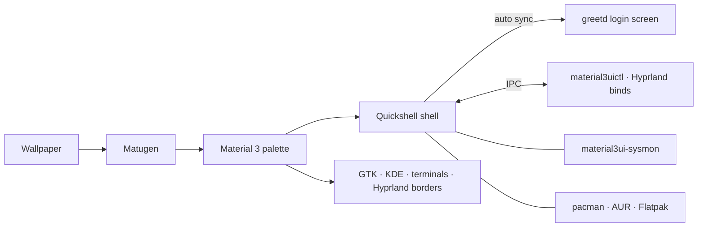

<p align="center">
  
</p>

<h1 align="center">Material3UI</h1>

<p align="center">
  <b>One design language, from the login screen to the package manager.</b><br/>
  A Material 3 desktop shell for Hyprland, written in Quickshell.
</p>

<p align="center">
  <a href="#install-in-one-line">Install</a> ·
  <a href="#a-tour">Tour</a> ·
  <a href="#make-it-yours">Customise</a> ·
  <a href="#faq">FAQ</a> ·
  <a href="https://github.com/Abijspy/material3-android-shell/releases/latest">Releases</a> ·
  <a href="CHANGELOG.md">Changelog</a>
</p>

<p align="center">
  
  
  
  
</p>

---

Most Linux desktops are a patchwork. The bar comes from one project, the lock screen from another, the login screen from a third, and updates run in a terminal. Each has its own fonts, colours and idea of what a button looks like.

**Material3UI replaces the patchwork with one shell.** Your wallpaper sets the colours. The same palette, shapes and motion carry through the bar, panels, notifications, lock screen, login screen, password prompts and update manager, and out into GTK, KDE and terminal apps.

## Install in one line

You need an Arch-based system (Arch, CachyOS, EndeavourOS, ...) with Hyprland 0.55 or newer.

```bash
bash -c "$(curl -fsSL https://raw.githubusercontent.com/Abijspy/material3-android-shell/main/install.sh)"
```

The installer walks you through seven short steps and asks before it changes anything. To see exactly what it would do first, clone the repo and run `./install.sh --dry-run`.

<details>
<summary><b>Installer options</b></summary>

| Flag | What it does |
| :--- | :--- |
| `--dry-run` | Show every package and file it would touch, and change nothing (from a local checkout) |
| `--yes` | Accept all defaults, for scripted or repeat installs |
| `--hypr full` · `inject` · `skip` | `full` installs the whole Hyprland config. `inject` adds the shell to your existing config. `skip` leaves Hyprland alone. |
| `--terminal` · `--file-manager` · `--browser` | Your apps. The defaults are Alacritty, Nemo and LibreWolf. |
| `--greeter` | Also install the greetd login screen (asks for sudo) |
| `--channel latest` · `release` | Follow `main` (default), or the latest tagged release |
| `--skip-deps` | Don't install packages; only deploy the configs |

The full walkthrough from a fresh system is in the [install guide](docs/INSTALL.md). Coming from KDE or GNOME? Read the [migration guide](docs/MIGRATION.md).

</details>

## A tour

From the moment the machine boots:

**1 · Log in.** The login screen runs on greetd and uses the same clock, password pill and entrance animation as the lock screen. Pick a user and a session, or suspend and shut down from there. When you change your wallpaper or avatar, the login screen picks it up automatically. → [Login screen](docs/GREETER.md)

**2 · The desktop.** The bar's centre holds a dynamic island. It grows to show the song that's playing, a pomodoro timer, a workspace switch or an incoming notification, then shrinks back.

**3 · Tap <kbd>Super</kbd>.** Spotlight opens. It finds apps, files and commands, does maths, and keeps your clipboard history and an emoji picker.

**4 · Swipe through the panels.**
- **Quick Settings:** Wi-Fi, Bluetooth, audio, brightness, night light, VPN.
- **Notification Centre** and **Dashboard:** clock, alarms, schedule and widgets.
- **Overview:** every workspace at a glance.

**5 · Change the wallpaper.** Use a static image, a video, an online collection or a Wallpaper Engine scene. Matugen builds a new Material 3 palette from it, and the whole desktop recolours, GTK, KDE, Alacritty, kitty and Hyprland's window borders included.

**6 · Something asks for your password.** The prompt comes from the shell's own polkit agent, so it looks like the rest of the desktop and not like a 2009 dialog box.

**7 · Updates arrive.** A status bar icon shows how many are pending.
- **Left-click** opens Packages & Updates, with official repo, AUR and Flatpak updates in one list.
- **Middle-click** runs the upgrade in your terminal.
- The **Repo**, **AUR** and **Flatpak** tabs search each source and install with one click.

→ [Packages & Updates](docs/PACKAGES.md)

**8 · Something feels slow.** <kbd>Ctrl</kbd><kbd>Alt</kbd><kbd>Del</kbd> opens the system monitor: CPU, memory, temperatures, disks, GPU and processes. Its data comes from `material3ui-sysmon`, a small bundled backend that reads `/proc` and `/sys` and needs only Python. → [System monitor](docs/SYSMON.md)

**9 · Grab part of the screen.** <kbd>Super</kbd><kbd>Shift</kbd><kbd>S</kbd> takes a region screenshot. There are also tools to read text (OCR), scan QR codes, search an image visually and record the screen.

## Keys worth learning

| | Open | | Do |
| :--- | :--- | :--- | :--- |
| <kbd>Super</kbd> tap | Spotlight | <kbd>Super</kbd><kbd>Return</kbd> | Terminal |
| <kbd>Super</kbd><kbd>Space</kbd> | App launcher | <kbd>Super</kbd><kbd>E</kbd> | File manager |
| <kbd>Super</kbd><kbd>N</kbd> | Quick Settings | <kbd>Super</kbd><kbd>B</kbd> | Browser |
| <kbd>Super</kbd><kbd>A</kbd> | Notifications | <kbd>Super</kbd><kbd>V</kbd> | Clipboard history |
| <kbd>Super</kbd><kbd>D</kbd> | Dashboard | <kbd>Super</kbd><kbd>.</kbd> | Emoji |
| <kbd>Super</kbd><kbd>Tab</kbd> | Overview | <kbd>Super</kbd><kbd>Shift</kbd><kbd>S</kbd> | Screenshot a region |
| <kbd>Super</kbd><kbd>G</kbd> | Quick actions | <kbd>Super</kbd><kbd>Shift</kbd><kbd>X</kbd> | Copy text from screen (OCR) |
| <kbd>Super</kbd><kbd>I</kbd> | Settings | <kbd>Super</kbd><kbd>Shift</kbd><kbd>R</kbd> | Record a region |
| <kbd>Ctrl</kbd><kbd>Super</kbd><kbd>T</kbd> | Wallpapers | <kbd>Super</kbd><kbd>L</kbd> | Lock |
| <kbd>Ctrl</kbd><kbd>Alt</kbd><kbd>Del</kbd> | System monitor | <kbd>Super</kbd><kbd>Esc</kbd> | Power menu |

Inside any panel, press <kbd>/</kbd> for the shortcut cheatsheet. Window and workspace binds (<kbd>Super</kbd><kbd>1…0</kbd>, <kbd>Super</kbd><kbd>Q</kbd>, <kbd>Super</kbd><kbd>F</kbd>, ...) are in [`keybinds.lua`](dotfiles/.config/hypr/material3ui/keybinds.lua). To change any of them, use **Settings → System → Keybinds** (see below).

## Make it yours

Most settings live in the built-in **Settings** app (<kbd>Super</kbd><kbd>I</kbd>): bar modules and layout, clock faces, lock screen style, fonts, UI scale, the update checker, login screen sync and more.

For everything else, here is which file to edit. Updates never overwrite the files marked ✎.

| I want to... | Edit |
| :--- | :--- |
| Use a different terminal, browser or file manager | ✎ `~/.config/hypr/material3ui/apps.lua` |
| Remap, disable or add keybinds | **Settings → System → Keybinds** (saved to ✎ `keybinds_custom.lua`) |
| Set left/right balance or per-channel volume | **Settings → Audio → Channels** |
| Add my own rules, monitors or autostart | ✎ `~/.config/hypr/material3ui/user.lua` |
| Understand the Hyprland setup | [docs/HYPRLAND.md](docs/HYPRLAND.md) |
| Script the shell from a terminal or another program | `material3uictl` (below) |

### Drive it from the terminal

Every panel and action is exposed through one IPC target, and `material3uictl` wraps it:

```bash
material3uictl dashboard              # toggle any panel by name
material3uictl wallpaper ~/sunset.jpg # apply a wallpaper; "next" cycles
material3uictl darkmode               # flip light / dark
material3uictl updates count          # pending updates, ready for scripts
material3uictl updates upgrade        # upgrade in a terminal
material3uictl lock
```

`material3uictl help` lists every command. The raw IPC target and the per-panel targets are documented in the [IPC reference](docs/IPC.md).

## Safe by default

A desktop shell touches a lot of your system, so the installer and updater are built to be predictable:

- **Nothing is overwritten silently.** Every replaced file is copied to `~/.config/material3ui/backups/<timestamp>/` first.
- **Everything is logged** to `~/.cache/material3ui/install-*.log`.
- **You review before it runs.** It lists missing packages (found with `pacman -T`) and every file it will write, and waits for your confirmation.
- **Updates keep your changes.** `./update.sh` preserves `apps.lua`, `user.lua`, your keybind edits and your colours, and remembers which Hyprland mode you chose.
- **Upgrades stay interactive.** Package installs and upgrades run in your own terminal, where you can see and answer every pacman or sudo prompt.
- **The login screen is optional** and installs separately. If its step fails, the rest of the install carries on.

## Under the hood



| Path | Contents |
| :--- | :--- |
| [`dotfiles/.config/quickshell/material3ui/`](dotfiles/.config/quickshell/material3ui) | The shell: panels, services, widgets |
| [`dotfiles/.config/hypr/`](dotfiles/.config/hypr) | Modular Hyprland Lua config |
| [`dotfiles/.config/matugen/`](dotfiles/.config/matugen) | Colour templates for other apps |
| [`greeter/`](greeter) | The greetd login screen and the `material3ui-greeter` tool |
| [`scripts/sysmon/`](scripts/sysmon) | The system monitor backend |
| [`data/dependencies.json`](data/dependencies.json) | What the installer installs ([readable list](docs/DEPENDENCIES.md)) |

## FAQ

<details>
<summary><b>Will it wreck my existing Hyprland config?</b></summary>

No. Pick `--hypr inject` and the installer adds three `require` lines to your existing `hyprland.lua` (backed up first). Pick `skip` and it doesn't touch Hyprland at all. With `full`, your old config is backed up before anything is replaced.
</details>

<details>
<summary><b>Does it work on Fedora, Debian or NixOS?</b></summary>

Not officially. The installer, the update checker and package search are built on pacman and the AUR. The shell itself is plain QML and may run elsewhere if you install the dependencies yourself, but that setup isn't supported.
</details>

<details>
<summary><b>How do I go back to what I had?</b></summary>

Copy the files from `~/.config/material3ui/backups/<timestamp>/` back into place. That folder mirrors the paths the installer replaced. Remove the `require("material3ui.…")` lines if you used inject mode, then reload Hyprland. To remove only the login screen, run `material3ui-greeter uninstall`.
</details>

<details>
<summary><b>Do I need an AUR helper?</b></summary>

For installing, yes: the installer bootstraps `paru` if neither paru nor yay is present. AUR *search* in Packages & Updates uses the AUR's web API, so it works without a helper. Installing AUR packages from there still needs one.
</details>

<details>
<summary><b>Can I see the login screen without logging out?</b></summary>

Yes: run `material3ui-greeter preview`.
</details>

## Credits

Material3UI began as a fork of **[NAnDoroid-shell](https://github.com/na-ive/nandoroid-shell)** by [na-ive](https://github.com/na-ive), and gratefully stays AGPL-3.0 like its parent. Since the fork it has added its own installer, Hyprland setup, login screen, polkit agent, package manager, system monitor and logo. See [NOTICE](NOTICE) for what changed, and the [upstream changelog](docs/UPSTREAM_CHANGELOG.md) for NAnDoroid's history.

It also stands on the work of:
- [Quickshell](https://quickshell.org) by outfoxxed: the framework.
- [end-4/dots-hyprland](https://github.com/end-4/dots-hyprland): architecture.
- [DankMaterialShell](https://github.com/AvengeMedia/DankMaterialShell): installer flow, config layout and system monitor design.
- [end4-pC](https://github.com/pctrade/end4-pC), [ii-p3drovfx](https://github.com/P3DROVFX/ii-p3drovfx), [ii-vynx](https://github.com/vaguesyntax/ii-vynx) and [Ambxst](https://github.com/Axenide/Ambxst): UI and dynamic island ideas.
- [google-weather-icons](https://github.com/mrdarrengriffin/google-weather-icons): weather icons.

**Contributing:** bug reports and pull requests are welcome. For anything large, open an issue first so we can agree on the direction.

<p align="center"><sub>Made for people who notice when the lock screen doesn't match the login screen.</sub></p>
