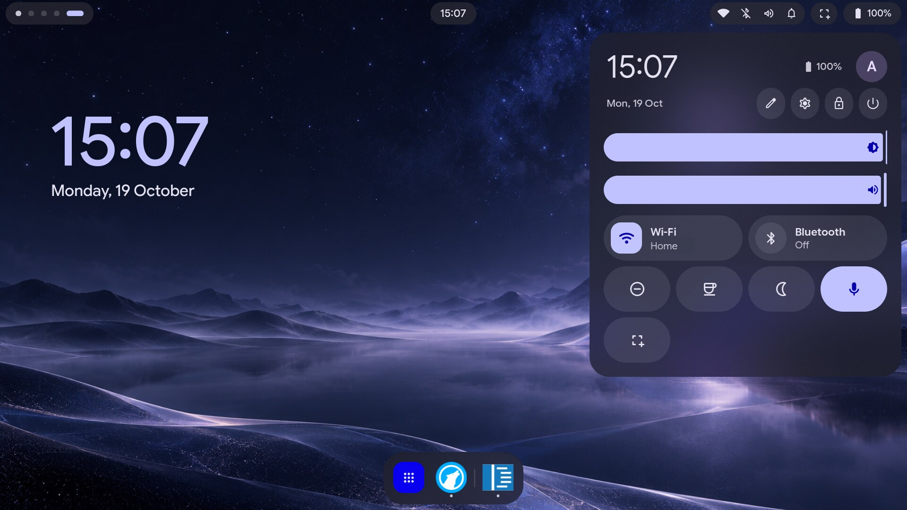
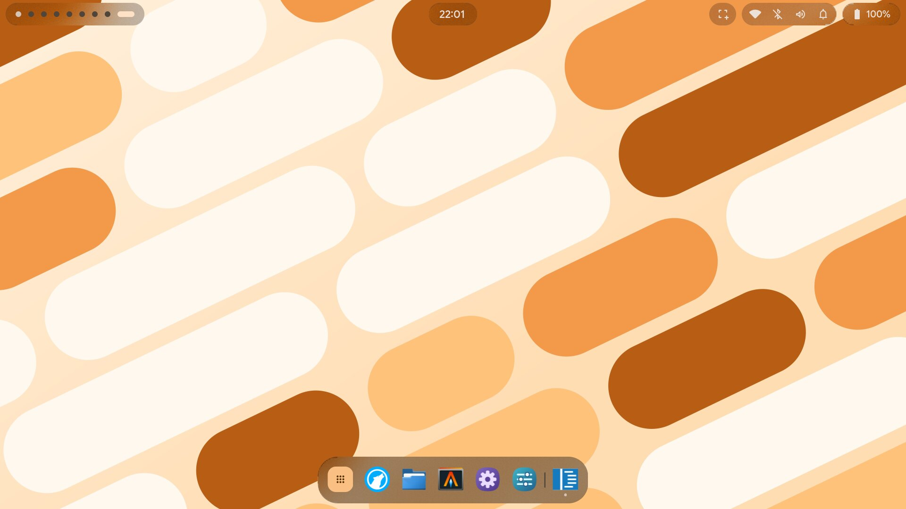
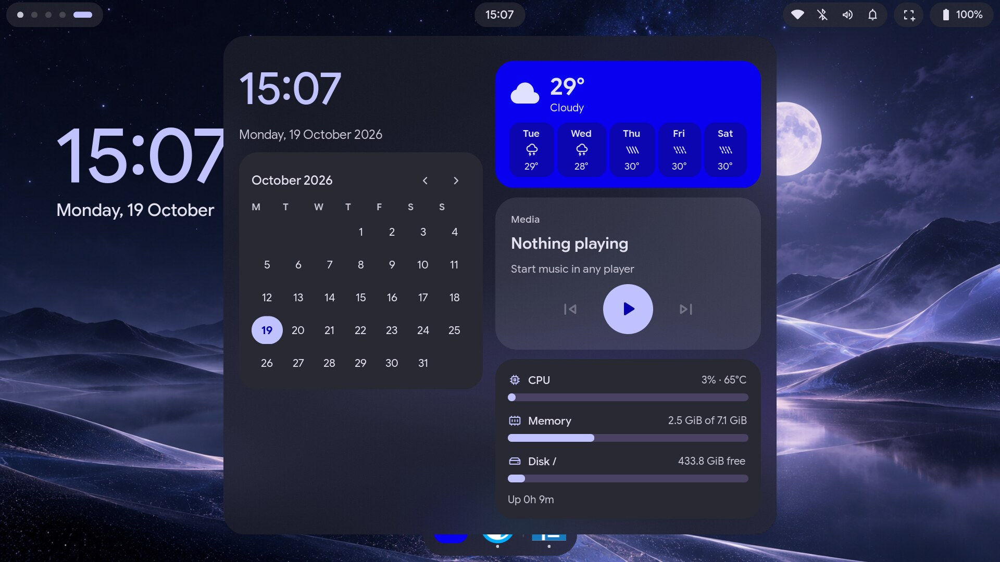
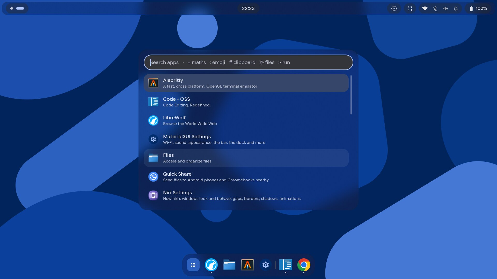
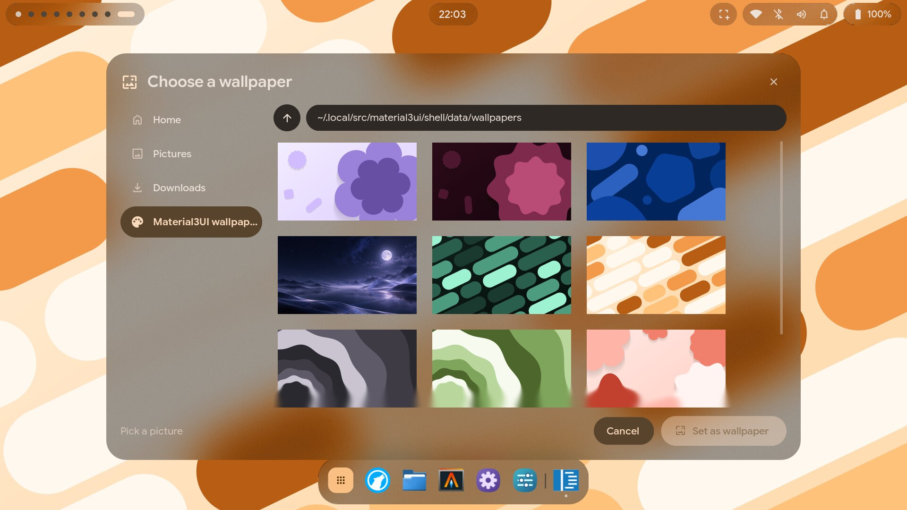
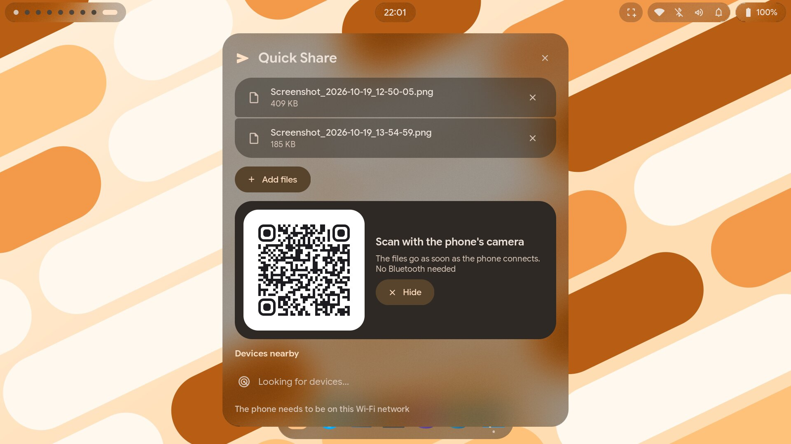
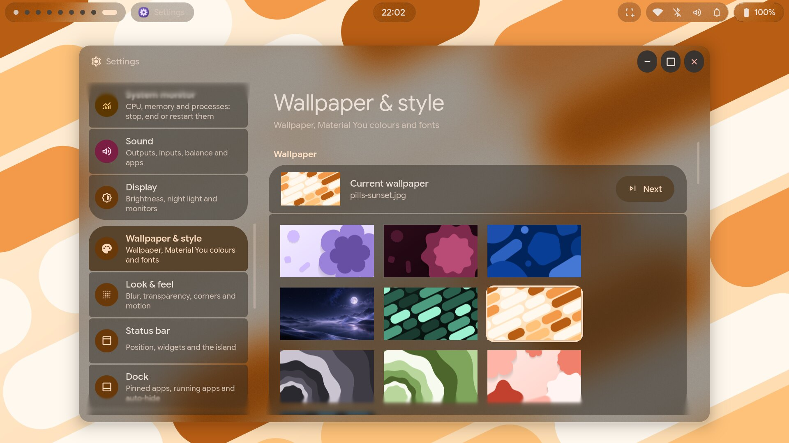
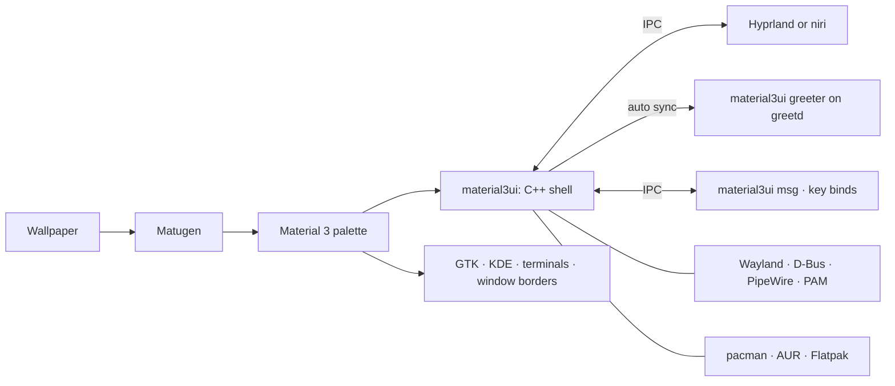

<p align="center">
  
</p>

<h1 align="center">Material3UI</h1>

<p align="center">
  <b>One design language, from the login screen to the package manager.</b><br/>
  A Material 3 desktop shell for Hyprland and niri, written in C++ for Wayland.
</p>

<p align="center">
  <a href="#screenshots">Screenshots</a> ·
  <a href="#install-in-one-line">Install</a> ·
  <a href="#hyprland-or-niri">Hyprland or niri</a> ·
  <a href="#a-tour">Tour</a> ·
  <a href="#make-it-yours">Customise</a> ·
  <a href="#faq">FAQ</a> ·
  <a href="https://github.com/Abijspy/material3-android-shell/releases/latest">Releases</a> ·
  <a href="CHANGELOG.md">Changelog</a>
</p>

<p align="center">
  
  
  
  
  
</p>

<p align="center">
  
</p>

---

Most Linux desktops are a patchwork. The bar comes from one project, the lock screen from another, the login screen from a third, and updates run in a terminal. Each has its own fonts, colours and idea of what a button looks like.

**Material3UI replaces the patchwork with one shell.** Your wallpaper sets the colours. The same palette, shapes and motion carry through the bar, dock, panels, notifications, lock screen, login screen, password prompts and update manager, and out into GTK, KDE and terminal apps.

**On Hyprland or niri.** The same shell runs on both compositors and finds out by itself which one it's on. Each gets its own settings app (Hyprland Settings or Niri Settings), its own blur and its own keys set up for you. Install one, or both and pick at the login screen. → [Hyprland or niri](#hyprland-or-niri)

**It's native.** The shell is one C++ program that talks to Wayland, D-Bus, PipeWire and PAM directly, and to Hyprland or niri over their own IPC. It renders every pixel itself with OpenGL ES and leaves the blur to the compositor. There's no Qt, QML or Quickshell.

**It's light on your machine.** Sitting idle, the whole shell (bar, dock, desktop and every service behind them) uses **under 0.1% of one CPU core** and draws about 20 frames a minute, when the clock or a status icon changes. It uses **about 75 MB of memory**, 25 MB of it its own; the rest is its share of the graphics libraries every app loads. [How it's measured](#how-its-measured).

## Screenshots

<table>
  <tr>
    <td></td>
    <td></td>
  </tr>
  <tr>
    <td align="center"><b>Desktop:</b> the bar, its dynamic island and the dock</td>
    <td align="center"><b>Dashboard:</b> calendar and agenda, weather, media and system</td>
  </tr>
  <tr>
    <td></td>
    <td></td>
  </tr>
  <tr>
    <td align="center"><b>Spotlight:</b> apps, maths, emoji, clipboard with previews, files</td>
    <td align="center"><b>Wallpapers:</b> ten ship with the shell, in its own file picker</td>
  </tr>
  <tr>
    <td></td>
    <td></td>
  </tr>
  <tr>
    <td align="center"><b>Quick Share:</b> files to and from Android phones, by QR code too</td>
    <td align="center"><b>Settings:</b> one app for the whole desktop, themed from your wallpaper</td>
  </tr>
</table>

These were taken on Hyprland. On niri the shell looks the same, over niri's scrolling columns of windows.

## Install in one line

You need an Arch-based system (Arch, CachyOS, EndeavourOS, ...). The shell runs on Hyprland 0.55 or newer, on niri 26.04 or newer, or on both. The installer asks which, and installs it if it isn't there.

```bash
bash -c "$(curl -fsSL https://raw.githubusercontent.com/Abijspy/material3-android-shell/main/install.sh)"
```

The installer asks a few questions, shows you one plan (packages, the shell build, every config it will write) and only then runs, with backups and a `restore.sh` for everything it replaces. To preview it, clone the repo and run `./install.sh --dry-run`.

- **Hyprland:** it installs Hyprland and the shell's modular Lua config, or adds the shell to the config you have.
- **niri:** it installs niri with xwayland-satellite (for X11 apps) and the GNOME portal (for screen sharing). Your `config.kdl` stays yours: the installer adds one `include "material3ui.kdl"` line at its end, and the shell's keys, blur and settings live in files beside it.
- **Both:** you choose Hyprland or niri at each login. The login screen shows each session with its compositor's logo.

<details>
<summary><b>Installer options</b></summary>

| Flag | What it does |
| :--- | :--- |
| `--dry-run` | Show every package and file it would touch, and change nothing (from a local checkout) |
| `--yes` | Accept all defaults, for scripted or repeat installs |
| `--compositor hyprland` · `niri` · `both` | What the shell runs on. The default is what's installed already (Hyprland when neither is). |
| `--hypr full` · `inject` · `skip` | `full` installs the whole Hyprland config. `inject` adds the shell to your existing config. `skip` leaves Hyprland alone. |
| `--niri include` · `skip` | `include` adds the shell to the end of your niri `config.kdl` (or niri's default config). `skip` leaves niri alone. |
| `--terminal` · `--file-manager` · `--browser` | Your apps. The defaults are Alacritty, Nemo and LibreWolf. |
| `--greeter` | Also install the greetd login screen (asks for sudo) |
| `--channel latest` · `release` | Follow `main` (default), or the latest tagged release |
| `--skip-deps` | Don't install packages; only build the shell and deploy the configs |
| `--restore [stamp]` | Put back the configs an install replaced (the last one by default) |
| `--uninstall` | Remove the shell from `/usr`; configs stay |

The full walkthrough from a fresh system is in the [install guide](docs/INSTALL.md), and niri's own in [Material3UI on niri](docs/NIRI.md). Coming from KDE or GNOME? Read the [migration guide](docs/MIGRATION.md).

</details>

## Hyprland or niri

Everything in the shell works on both: the bar with each monitor's workspaces, the dock, every panel, notifications, Spotlight, the window switcher, screenshots and recording, the lock and login screens, Digital Wellbeing, hooks and the IPC. What differs is the compositor underneath.

| | Hyprland | niri |
| :--- | :--- | :--- |
| **Windows** | Tiled into the screen (dwindle or master), floating, or Hyprland's scrolling layout | Built around scrolling columns: new windows open to the right and the view follows |
| **Its settings app** | **Hyprland Settings:** every Hyprland option, displays, animations, keybinds, rules, plugins and profiles | **Niri Settings:** layout, borders and shadows, blur, animations, behaviour, keys, window rules, startup apps and variables |
| **Blur** | Hyprland's, behind the bar, panels and dock, and behind the apps you pick | niri's (26.04), the same places, and behind the workspaces in the overview |
| **Overview** (<kbd>Super</kbd><kbd>`</kbd>) | The shell's | niri's own, over a blurred wallpaper |
| **Spotlight** | Tap <kbd>Super</kbd> | <kbd>Super</kbd><kbd>Space</kbd> (niri can't bind <kbd>Super</kbd> on its own) |
| **Your changes go in** | `~/.config/hypr/material3ui/`: `user.lua`, `apps.lua`, `keybinds_custom.lua` | `~/.config/niri/`: your `config.kdl` and `material3ui-user.kdl` |
| **Only on Hyprland** | Minimising, recording one window, the shell's screen-sharing picker, the magnifier and colour filters | niri has no minimised state, zoom or screen shaders, and shares the screen through the GNOME portal's picker |
| **The login screen runs on** | Hyprland | niri, when Hyprland isn't installed |

Hyprland is the shell's first home and the most complete. Pick niri if you like scrollable tiling: the rest of the desktop comes with you. → [Material3UI on niri](docs/NIRI.md) · [The Hyprland setup](docs/HYPRLAND.md)

## A tour

From the moment the machine boots:

**1 · Log in.** The login screen runs on greetd and is the lock screen's twin: the same clock, widgets, weather, password pill and motion, on frosted glass. Pick a user and a session (Hyprland or niri, each with its logo), or suspend and shut down from there. When you change your wallpaper, avatar, keyboard layout or monitors in Settings, the login screen picks them up automatically. → [Login screen](docs/GREETER.md)

**2 · The desktop.** The bar is yours to arrange: drop widgets (weather, date, media, CPU, notifications, clipboard, screenshot and more) into its left, centre and right, or right-click it to edit it in place. It shows each monitor's own workspaces, as many as Hyprland or niri has. Its centre holds a dynamic island. It grows to show the song that's playing, a workspace switch or an incoming notification, then shrinks back. The bar and panels are translucent with the compositor's blur behind them. A dock on the bottom edge keeps your pinned and running apps, and slides away until you need it.

**3 · Tap <kbd>Super</kbd>** (on niri, <kbd>Super</kbd><kbd>Space</kbd>). Spotlight opens. It finds apps, files and commands, does maths, and has an emoji picker. <kbd>Super</kbd><kbd>V</kbd> opens the clipboard history, images included.

**4 · Open the panels.**
- **Quick Settings:** volume, brightness, Wi-Fi, Bluetooth, Do Not Disturb, Caffeine, night light, and the connected network's live download and upload speed.
- **Notification Centre** and **Dashboard:** notifications, the clock, a calendar (your country's public holidays in red) and the week's weather.
- **Clock:** alarms, once or on the days you pick, and timers counting down in rings. When one goes off, a card at the top of the screen (or on the lock screen) snoozes or stops it. The bar, the desktop and the lock screen each have an Alarms & timers widget.
- **Overview:** every workspace at a glance. On niri it's niri's own overview, with your wallpaper blurred behind the workspaces.

**5 · Change the wallpaper.** Ten wallpapers ship with the shell, eight of them drawn from Material 3 Expressive shapes (<kbd>Ctrl</kbd><kbd>Super</kbd><kbd>T</kbd>). Pick one or your own image and Matugen builds a new Material 3 palette from it, or seed the palette from an accent colour you choose. The whole desktop recolours: GTK, KDE, Alacritty and kitty, Hyprland's window borders and niri's focus ring.

**6 · Lock the screen.** <kbd>Super</kbd><kbd>L</kbd> shows a clock and the widgets you picked: date, weather, forecast, media, battery and a notification count. Rearrange it on a grid in the full-screen lock screen editor (Settings → Lock screen).

**7 · Something asks for your password.** The prompt comes from the shell's own polkit agent, so it looks like the rest of the desktop and not like a 2009 dialog box.

**8 · Updates arrive.** The shell checks in the background (daily, unless you change it) and tells you when there's something new. The **Updates** bar widget shows how many are waiting.
- **Left-click** opens Software & updates, with official repo, AUR, Flatpak and Material3UI updates in one list, installed with one password.
- **Middle-click** starts the update straight away.
- The **Repositories** tab switches on multilib or testing, adds your own repositories, holds packages back, finds the fastest mirrors near you and manages Flatpak's remotes.
- The **Official**, **AUR** and **Flatpak** tabs search each source and install with one click.
- **Settings → Firmware** updates your devices' firmware (the BIOS, SSDs, docks…) from the LVFS through fwupd.

→ [Software, updates and firmware](docs/PACKAGES.md)

**9 · Something feels slow.** <kbd>Ctrl</kbd><kbd>Alt</kbd><kbd>Del</kbd> opens the system monitor: CPU, memory, disks and processes, read straight from `/proc`.

**10 · Grab part of the screen.** <kbd>Super</kbd><kbd>G</kbd> opens the screenshot tool, which captures a region, a window or the whole screen, with a delay. Shots are copied to the clipboard and can open in an editor. <kbd>Super</kbd><kbd>Shift</kbd><kbd>S</kbd> grabs a region straight away. <kbd>Super</kbd><kbd>Shift</kbd><kbd>X</kbd> copies the text in a region (OCR), and <kbd>Super</kbd><kbd>Shift</kbd><kbd>R</kbd> starts or stops a screen recording. Its Record tab records a region, a screen or (on Hyprland) a window as MP4, WebM, MKV or GIF, at the resolution, frame rate and quality you pick, with system sound or the microphone. On Hyprland, when an app asks to share your screen, the shell's own picker asks what it may see: a screen, a window or a region.

## Keys worth learning

The same keys on both compositors, except where the table says otherwise.

| | Open | | Do |
| :--- | :--- | :--- | :--- |
| <kbd>Super</kbd> tap | Spotlight (on niri, <kbd>Super</kbd><kbd>Space</kbd>) | <kbd>Super</kbd><kbd>Return</kbd> | Terminal |
| <kbd>Super</kbd><kbd>Space</kbd> | App launcher (Hyprland) | <kbd>Super</kbd><kbd>E</kbd> | File manager |
| <kbd>Super</kbd><kbd>N</kbd> | Quick Settings | <kbd>Super</kbd><kbd>B</kbd> | Browser |
| <kbd>Super</kbd><kbd>A</kbd> | Notifications | <kbd>Super</kbd><kbd>V</kbd> | Clipboard history |
| <kbd>Super</kbd><kbd>D</kbd> | Dashboard | <kbd>Super</kbd><kbd>.</kbd> | Emoji |
| <kbd>Super</kbd><kbd>Tab</kbd> | Switch windows (hold Super) | <kbd>Super</kbd><kbd>Shift</kbd><kbd>S</kbd> | Screenshot a region |
| <kbd>Super</kbd><kbd>G</kbd> | Screenshot tool | <kbd>Super</kbd><kbd>Shift</kbd><kbd>X</kbd> | Copy text from screen (OCR) |
| <kbd>Super</kbd><kbd>I</kbd> | Settings | <kbd>Super</kbd><kbd>Shift</kbd><kbd>R</kbd> | Record a region |
| <kbd>Ctrl</kbd><kbd>Super</kbd><kbd>T</kbd> | Wallpapers | <kbd>Super</kbd><kbd>L</kbd> | Lock |
| <kbd>Ctrl</kbd><kbd>Alt</kbd><kbd>Del</kbd> | System monitor | <kbd>Super</kbd><kbd>Esc</kbd> | Power menu |
| <kbd>Super</kbd><kbd>`</kbd> | Overview | | |

Keys for windows and workspaces:
- **Hyprland:** the shell's own (<kbd>Super</kbd><kbd>1…0</kbd>, <kbd>Super</kbd><kbd>Q</kbd>, <kbd>Super</kbd><kbd>F</kbd>, ...), in [`keybinds.lua`](dotfiles/.config/hypr/material3ui/keybinds.lua). Change any of them in **Hyprland Settings → Keybinds**.
- **niri:** niri's own, from your `config.kdl`: <kbd>Super</kbd><kbd>Q</kbd> closes, <kbd>Super</kbd><kbd>F</kbd> maximises a column, <kbd>Super</kbd><kbd>R</kbd> cycles its width, and the arrows and <kbd>Super</kbd><kbd>1…9</kbd> move around. The shell's keys, in [`material3ui.kdl`](dotfiles/.config/niri/material3ui.kdl), take over the few that clash (<kbd>Super</kbd><kbd>D</kbd>, <kbd>Super</kbd><kbd>T</kbd>, <kbd>Super</kbd><kbd>V</kbd>, <kbd>Super</kbd><kbd>L</kbd>…). Rebind any key in **Niri Settings → Keys**, or in `material3ui-user.kdl`, which is read last.

## Make it yours

Most settings live in the built-in **Settings** app (<kbd>Super</kbd><kbd>I</kbd>, or the gear in Quick Settings). It has pages for:
- **Network:** Wi-Fi and Ethernet with the connection's details and live speeds, VPN (WireGuard, OpenVPN, Cloudflare WARP) and the firewall.
- **Devices:** Bluetooth, printers, sound (with left/right balance), display, mouse and touchpad, keyboard, battery and storage.
- **Look:** wallpaper and colour, and Look & feel: blur (and blur behind the apps you pick), transparency, corner roundness and animation speed.
- **Bar and dock:** the status bar and the dock. The bar has whole looks a tap away (Material 3's pills, a single bar, or Caelestia's side bar framing the screen), any edge (top, bottom, left or right), four styles, and a widget editor.
- **Lock screen and weather:** the clock and widgets on the lock and login screens; your location, units and forecast.
- **Tools:** clipboard and screenshots, default apps, and the system monitor.
- **You:** notifications, Digital Wellbeing (screen time, app timers, Focus mode), accessibility, security (lock, idle and sleep), users, and the system's date, time and language.
- **Calendar and clock:** your events, subscribed calendars and public holidays; alarms, timers, their sound and snooze.
- **Hooks:** your own commands when things happen (the screen locks, the wallpaper changes, the battery runs low, a notification arrives, a screenshot is saved, an alarm goes off, updates arrive: 45 events in all), each with a test run and its last result.
- **Software & updates, Firmware, and About:** updates with automatic checks, repositories and mirrors, your devices' firmware, and this device with its compositor's logo.

The mouse and touchpad, keyboard layouts and shortcuts, monitors, cursor and night light work on either compositor. On niri they're written to niri's config as you change them, and niri applies them at once.

### The compositor's own settings app

Next to Settings sits an app for the compositor itself: **Hyprland Settings** in a Hyprland session, **Niri Settings** in a niri one. Open it from the launcher, the card at the top of Settings' sidebar, the dock (one pin that follows the session), or `material3ui msg hyprsettings`. Changes apply as you make them.

**Hyprland Settings** saves at once, undoes with <kbd>Ctrl</kbd><kbd>Z</kbd> and resets each option to what your config files had. It has:
- **Every Hyprland option** (all of them, read from the running Hyprland, so new ones appear on their own): windows and borders, decoration, layouts, input devices, gestures, cursor, groups, behaviour, rendering and debug, with Hyprland's config errors on top.
- **Displays:** drag monitors into place; resolution, refresh rate, scale, rotation, VRR, 10-bit colour, HDR and mirroring. Anything that could leave the screen unusable reverts by itself unless you keep it.
- **Animations:** every animation's length, curve and style, and a curve editor with presets and a live preview.
- **Keybinds:** press a shortcut to set it; binds for any action or command, and mouse drags.
- **Rules:** window, layer and workspace rules, picked from the windows and layers on screen.
- **Startup apps and environment variables.**
- **Cursor themes** (Bibata by default, offered to install when missing), **plugins** (hyprpm, with a catalogue to download and install) **and profiles** (whole setups saved by name; `material3ui msg hypr profile next` switches from a keybind).

Its changes live in `hyprland_custom.lua`, applied after the rest of your config. → [Hyprland Settings](docs/HYPRLAND.md#hyprland-settings)

**Niri Settings** starts each option from what your `config.kdl` says (or niri's default) and writes only what you change, so the rest of your config stays in charge. **Back to config.kdl** at the foot of a page forgets that page's changes. It has:
- **Windows & layout:** gaps, centring the focused column or a lone one, how wide new windows open, and space kept free at each edge.
- **Borders & shadows:** the focus ring and border in the wallpaper's colours, shadows, window corners, and niri's blur: passes, smoothness, noise and saturation.
- **Animations:** each of niri's animations on or off, with a curve drawn in the curve editor or a spring with its bounce and stiffness.
- **Behaviour:** focus following the mouse, the pointer following the focus, the hot corner, drawing tablets, the overview's size and its blurred backdrop.
- **Keys:** a key for any of niri's actions or for a command, with every key your `config.kdl` binds listed in words.
- **Window rules:** for an open app or app ids matching a regex: floating, maximised, full screen, a width, see-through, hidden from screen sharing, or a border colour from the palette.
- **Startup apps and environment variables**, beside the ones your config sets.

Its changes live in `material3ui-settings.kdl`, which niri merges into your config field by field. → [Niri Settings](docs/NIRI.md#niri-settings)

### Which file to edit

For everything else, here is where to go. Updates never overwrite the files marked ✎.

| I want to... | On Hyprland | On niri |
| :--- | :--- | :--- |
| Use a different terminal, browser or file manager | ✎ `~/.config/hypr/material3ui/apps.lua` | **Niri Settings → Keys** and **Environment**, or re-run the installer with `--terminal` and friends |
| Remap, disable or add keys | **Hyprland Settings → Keybinds** (saved to ✎ `keybinds_custom.lua`) | **Niri Settings → Keys**, or ✎ `~/.config/niri/material3ui-user.kdl` |
| Change how windows look, move and behave | **Hyprland Settings** (saved to `hyprland_custom.lua`) | **Niri Settings** (saved to `material3ui-settings.kdl`) |
| Write my own config by hand | ✎ `~/.config/hypr/material3ui/user.lua` | ✎ your `~/.config/niri/config.kdl`, or ✎ `material3ui-user.kdl` to win over the shell's |
| Understand the setup | [docs/HYPRLAND.md](docs/HYPRLAND.md) | [docs/NIRI.md](docs/NIRI.md) |

And on either compositor:

| I want to... | Go to |
| :--- | :--- |
| Rearrange the bar | **Settings → Status bar → Widgets**, or right-click the bar |
| Give the bar another look (Caelestia, a single bar) or edge | **Settings → Status bar → Looks**, then **Layout** |
| Change the lock screen | **Settings → Lock screen → Open editor** (the login screen follows) |
| Blur the windows of my terminal, file manager or other apps | **Settings → Look & feel → Blur behind apps** |
| Set the weather location | **Settings → Weather** |
| Pin apps to the dock | **Settings → Dock**, or right-click an app in the dock |
| Script the shell from a terminal or another program | `material3ui msg` (below) |

### Drive it from the terminal

Every panel and action is a command on the shell's IPC socket, sent with `material3ui msg`, the same on Hyprland and niri:

```bash
material3ui msg popup dashboard              # toggle a panel
material3ui msg settings dock                # open Settings on a page
material3ui msg hyprsettings                 # Hyprland Settings, or Niri Settings on niri
material3ui msg wallpaper set ~/sunset.jpg   # apply a wallpaper; "next" cycles
material3ui msg screenshot region            # or window, screen, ocr
material3ui msg volume set 40
material3ui msg lock
material3ui msg hooks set session_locked "playerctl pause"   # a hook: run on an event
```

`material3ui msg help` lists every command, and the [IPC reference](docs/IPC.md) documents them. Every event (a lock, a new wallpaper, a screenshot saved…) is also written as a line of JSON to `$XDG_RUNTIME_DIR/material3ui/events.jsonl`, so scripts and automated tests can wait for what they set off (`material3ui events wait screenshot_taken`): [Hooks and events](docs/IPC.md#hooks-and-events).

## Safe by default

A desktop shell touches a lot of your system, so the installer and updater are built to be predictable:

- **Nothing is overwritten silently.** Every replaced file is copied to `~/.config/material3ui/backups/<timestamp>/` first.
- **Everything is logged** to `~/.cache/material3ui/install-*.log`.
- **You review before it runs.** It lists missing packages (found with `pacman -T`) and every file it will write, and waits for your confirmation.
- **Your compositor config stays yours.** On Hyprland, `inject` adds three lines to your `hyprland.lua`. On niri, the installer adds one `include` line to your `config.kdl` and warns you if it starts something the shell replaces (a bar, a notification daemon, a wallpaper tool). Each config is checked with the compositor (`Hyprland --verify-config`, `niri validate`) after it's written.
- **Updates keep your changes.** `./update.sh` rebuilds the shell and preserves `apps.lua`, `user.lua`, your keybind edits, your niri `config.kdl` and `material3ui-user.kdl`, and your colours, and remembers how you set up Hyprland and niri.
- **Upgrades stay interactive.** Package installs and upgrades run in your own terminal, where you can see and answer every pacman or sudo prompt.
- **The login screen is optional** and installs separately. If its step fails, the rest of the install carries on.

## Under the hood



| Path | Contents |
| :--- | :--- |
| [`shell/`](shell) | The shell: Wayland, rendering, services and every panel, in C++ ([architecture](shell/README.md)) |
| [`dotfiles/.config/hypr/`](dotfiles/.config/hypr) | Modular Hyprland Lua config |
| [`dotfiles/.config/niri/`](dotfiles/.config/niri) | `material3ui.kdl`: the shell's part of a niri config (startup, your apps, keys, and the include for what Settings writes) |
| [`dotfiles/.config/matugen/`](dotfiles/.config/matugen) | Colour templates for other apps |
| [`dotfiles/.local/share/material3ui/`](dotfiles/.local/share/material3ui) | Theme hooks Matugen runs (GTK, KDE, terminals) |
| [`greeter/`](greeter) | The greetd sessions for the login screen (on Hyprland or niri) and the `material3ui-greeter` tool |
| [`data/dependencies.json`](data/dependencies.json) | What the installer installs, per compositor ([readable list](docs/DEPENDENCIES.md)) |

### How it's measured

On a Ryzen 5 5500U laptop with Radeon graphics, Hyprland 0.56 and one 1920×1080 screen at 1.5× scale, with the default bar, dock and desktop and nothing else open:

- **CPU:** the shell's own CPU time over 60 seconds, starting a minute after it launched (`/proc/<pid>/stat`): 0.08%.
- **Frames:** 23 in that minute, counted with `M3_DEBUG_FRAMES=1`.
- **Memory:** 74 MB PSS, 25 MB of it anonymous (`/proc/<pid>/smaps_rollup`), plus 4 MB for the small supervisor that restarts the shell if it crashes. PSS splits shared libraries fairly between the programs that use them; RSS counts them in full, so it reads about twice as high.

Animations draw at your screen's refresh rate only while they run. Endless ones, like the music waves, draw at 30 fps, and long titles scroll three times and then rest, as on Android.

## FAQ

<details>
<summary><b>Should I pick Hyprland or niri?</b></summary>

Pick the way you like to work. Hyprland tiles windows into the screen (or scrolls them, in its scrolling layout), has an option for nearly everything, and is the shell's most complete home: minimising, recording a single window, the shell's own screen-sharing picker and the magnifier are Hyprland-only. niri lays windows out in columns you scroll through, and the rest of the shell is the same there. Not sure? Install both (`--compositor both`) and choose at the login screen. → [Hyprland or niri](#hyprland-or-niri)
</details>

<details>
<summary><b>Will it wreck my existing Hyprland or niri config?</b></summary>

No. On Hyprland, pick `--hypr inject` and the installer adds three `require` lines to your existing `hyprland.lua` (backed up first). Pick `skip` and it doesn't touch Hyprland at all. With `full`, your old config is backed up before anything is replaced. On niri, your `config.kdl` gets one `include "material3ui.kdl"` line at its end (backed up first), or nothing with `--niri skip`. Everything the shell sets for niri lives in its own files beside your config.
</details>

<details>
<summary><b>I already use Material3UI on Hyprland. How do I add niri?</b></summary>

Run `./install.sh --compositor both` once, then log out and choose niri at the login screen. Your Hyprland setup stays as it is. To do it by hand instead, see [Material3UI on niri](docs/NIRI.md#by-hand).
</details>

<details>
<summary><b>Does it work on Sway, river or another compositor?</b></summary>

Not yet. The shell talks to Hyprland and niri over their own IPC for workspaces, windows and settings, and those two are what it supports.
</details>

<details>
<summary><b>Does it work on Fedora, Debian or NixOS?</b></summary>

Not officially. The installer, the update checker and package search are built on pacman and the AUR. The shell itself builds with meson wherever its libraries exist, but other setups aren't supported.
</details>

<details>
<summary><b>How do I go back to what I had?</b></summary>

Run `./install.sh --restore`, or copy the files from `~/.config/material3ui/backups/<timestamp>/` back into place: that folder mirrors the paths the installer replaced. If you used inject mode on Hyprland, remove the `require("material3ui.…")` lines and reload Hyprland. On niri, remove the `include "material3ui.kdl"` line from your `config.kdl`. To remove only the login screen, run `material3ui-greeter uninstall`.
</details>

<details>
<summary><b>Do I need an AUR helper?</b></summary>

For installing, yes: the installer uses yay, and installs it if it's missing. AUR *search* in Software & updates uses the AUR's web API, so it works without a helper. Installing AUR packages from there still needs one.
</details>

<details>
<summary><b>I used v3. What happened to Quickshell?</b></summary>

v4 replaced it with the native shell. The installer and `update.sh` build it, back up and remove `~/.config/quickshell/material3ui`, and switch Hyprland to start `material3ui`. Your keybinds, wallpaper and colours carry over. `material3uictl` is gone: use `material3ui msg` instead. You can uninstall `quickshell-git` afterwards.
</details>

<details>
<summary><b>Can I see the login screen without logging out?</b></summary>

Yes: run `material3ui-greeter preview`.
</details>

## Credits

Material3UI began as a fork of **[NAnDoroid-shell](https://github.com/na-ive/nandoroid-shell)** by [na-ive](https://github.com/na-ive), and is MIT-licensed with its authors' permission. Since the fork it has added its own installer, Hyprland and niri setups, login screen, polkit agent, package manager and logo, and in v4 it was rewritten as a native C++ shell. Its architecture follows [Noctalia](https://github.com/noctalia-dev/noctalia), though none of Noctalia's code is used. See [NOTICE](NOTICE) for what changed, and the [upstream changelog](docs/UPSTREAM_CHANGELOG.md) for NAnDoroid's history.

It also stands on the work of:
- [Hyprland](https://hypr.land) and [niri](https://github.com/YaLTeR/niri), the compositors it runs on. Their logos appear in the shell under their own licences (see [NOTICE](NOTICE)).
- [Quickshell](https://quickshell.org) by outfoxxed: the framework v1–v3 were built on.
- [end-4/dots-hyprland](https://github.com/end-4/dots-hyprland): architecture.
- [DankMaterialShell](https://github.com/AvengeMedia/DankMaterialShell): installer flow, config layout and system monitor design.
- [end4-pC](https://github.com/pctrade/end4-pC), [ii-p3drovfx](https://github.com/P3DROVFX/ii-p3drovfx), [ii-vynx](https://github.com/vaguesyntax/ii-vynx) and [Ambxst](https://github.com/Axenide/Ambxst): UI and dynamic island ideas.
- [google-weather-icons](https://github.com/mrdarrengriffin/google-weather-icons): weather icons.
- [HyprMod](https://github.com/BlueManCZ/hyprmod) by BlueManCZ: the features Hyprland Settings set out to bring in (written from scratch here; none of HyprMod's code or data is used).

**Contributing:** bug reports and pull requests are welcome. For anything large, open an issue first so we can agree on the direction.

<p align="center"><sub>Made for people who notice when the lock screen doesn't match the login screen.</sub></p>
