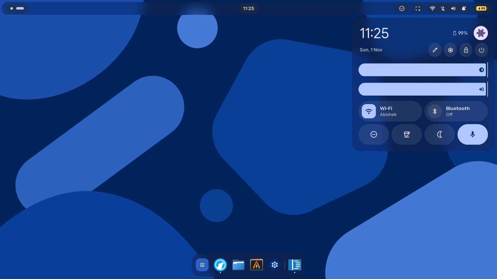
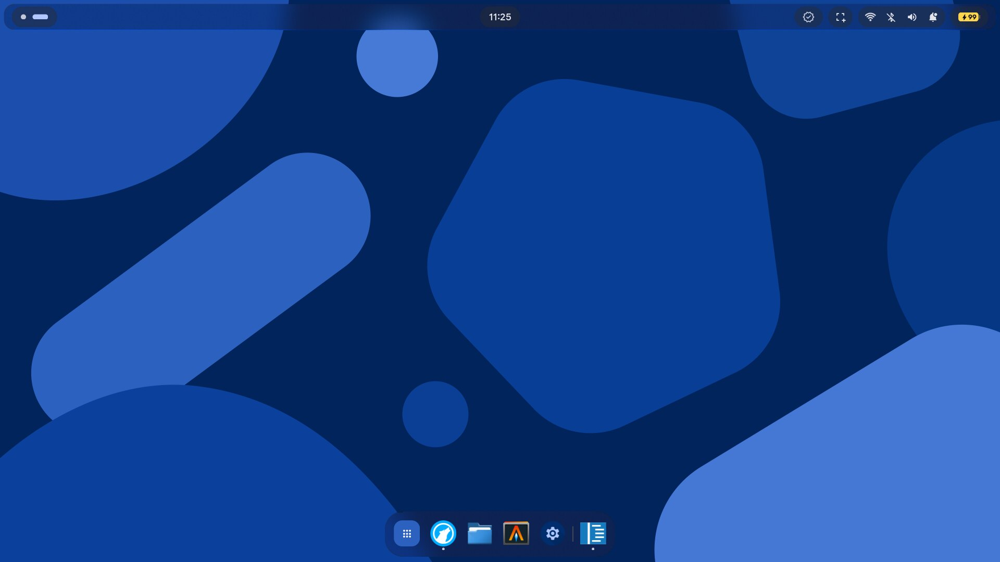
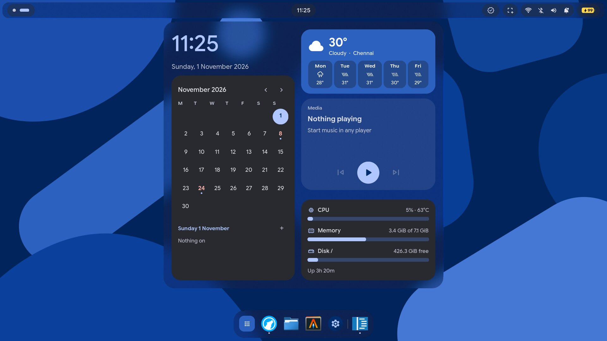
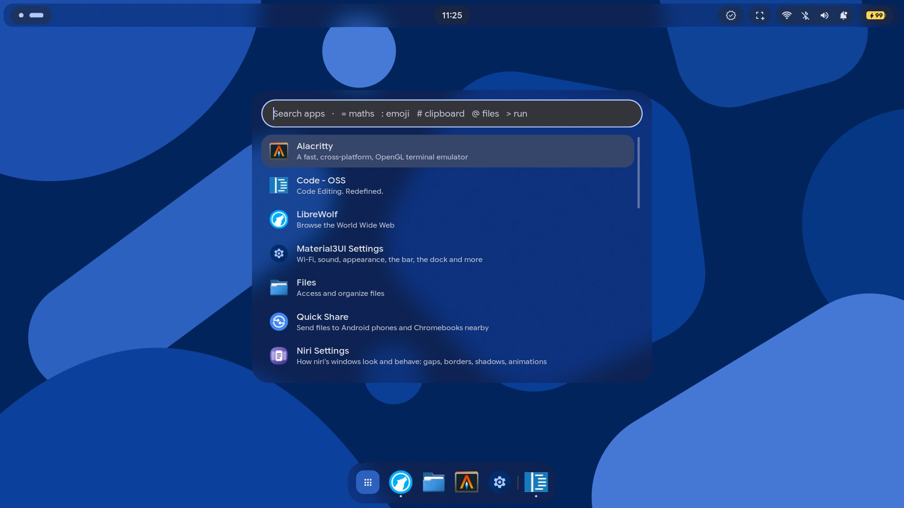
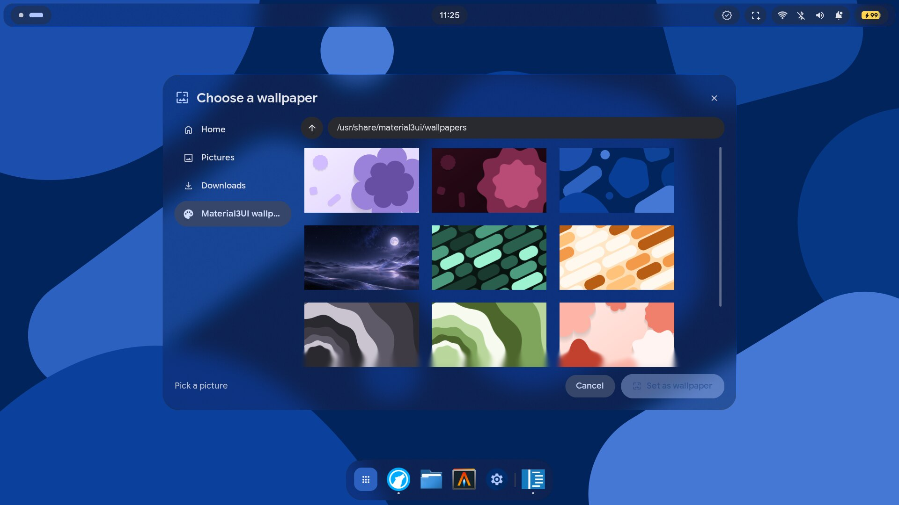
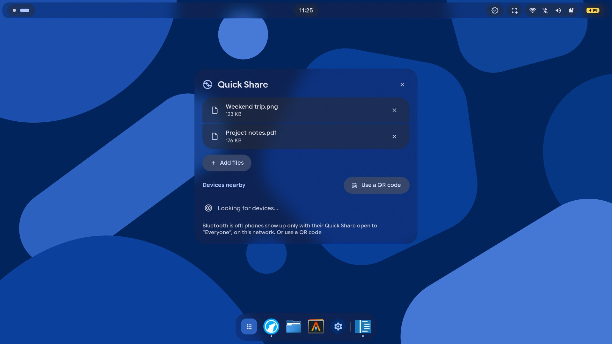
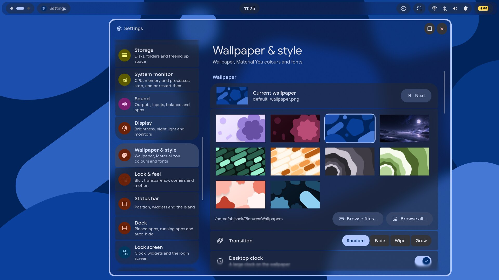
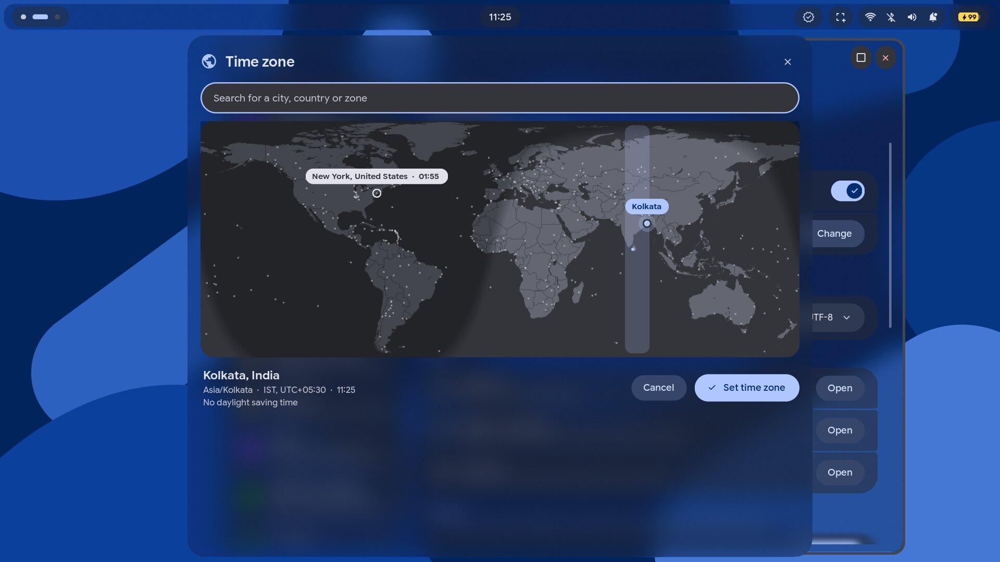
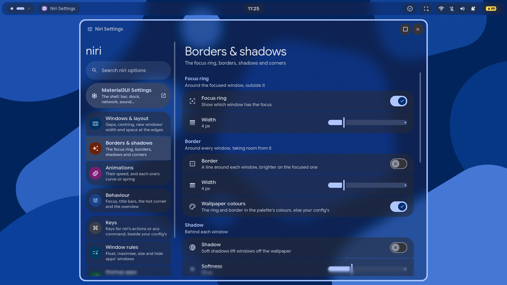
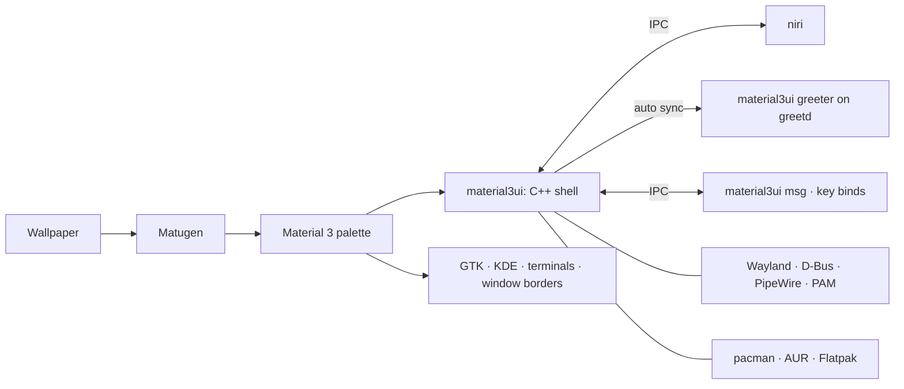

<p align="center">
  
</p>

<h1 align="center">Material3UI</h1>

<p align="center">
  <b>One design language, from the login screen to the package manager.</b><br/>
  A Material 3 desktop shell for niri, written in C++ for Wayland.
</p>

<p align="center">
  <a href="#screenshots">Screenshots</a> ·
  <a href="#install-in-one-line">Install</a> ·
  <a href="#on-niri">On niri</a> ·
  <a href="#a-tour">Tour</a> ·
  <a href="#make-it-yours">Customise</a> ·
  <a href="#repository-structure">Code</a> ·
  <a href="#faq">FAQ</a> ·
  <a href="https://github.com/Abijspy/material3-android-shell/releases/latest">Releases</a> ·
  <a href="CHANGELOG.md">Changelog</a>
</p>

<p align="center">
  
  
  
  
</p>

<p align="center">
  
</p>

---

Most Linux desktops are a patchwork. The bar comes from one project, the lock screen from another, the login screen from a third, and updates run in a terminal. Each has its own fonts, colours and idea of what a button looks like.

**Material3UI replaces the patchwork with one shell.** Your wallpaper sets the colours. The same palette, shapes and motion carry through the bar, dock, panels, notifications, lock screen, login screen, password prompts and update manager, and out into GTK, KDE and terminal apps.

**Made for niri.** The shell runs on [niri](https://github.com/niri-wm/niri), the scrollable-tiling compositor, with its own Niri Settings app, niri's blur behind the bar and panels, and keys set up for you. Your `config.kdl` stays yours. → [On niri](#on-niri)

**It's native.** The shell is one C++ program that talks to Wayland, D-Bus, PipeWire and PAM directly, and to niri over its own IPC. It renders every pixel itself with OpenGL ES and leaves the blur to the compositor. There's no Qt, QML or Quickshell.

**It's light on your machine.** Sitting idle, the whole shell (bar, dock, desktop and every service behind them) uses **under 0.1% of one CPU core** and draws about 20 frames a minute, when the clock or a status icon changes. It uses **about 75 MB of memory**, 25 MB of it its own; the rest is its share of the graphics libraries every app loads. [How it's measured](#how-its-measured).

## Screenshots

<table>
  <tr>
    <td></td>
    <td></td>
  </tr>
  <tr>
    <td align="center"><b>Desktop:</b> the bar, its dynamic island and the dock</td>
    <td align="center"><b>Dashboard:</b> calendar and agenda, weather, media and system</td>
  </tr>
  <tr>
    <td></td>
    <td></td>
  </tr>
  <tr>
    <td align="center"><b>Spotlight:</b> apps, maths, emoji, clipboard with previews, files</td>
    <td align="center"><b>Wallpapers:</b> ten ship with the shell, in its own file picker</td>
  </tr>
  <tr>
    <td></td>
    <td></td>
  </tr>
  <tr>
    <td align="center"><b>Quick Share:</b> files to and from Android phones, by QR code too</td>
    <td align="center"><b>Settings:</b> one app for the whole desktop, themed from your wallpaper</td>
  </tr>
  <tr>
    <td></td>
    <td></td>
  </tr>
  <tr>
    <td align="center"><b>Time zone:</b> pick yours on a world map, with the night side shaded</td>
    <td align="center"><b>Niri Settings:</b> borders, blur, animations, keys and rules for niri</td>
  </tr>
</table>

## Install in one line

You need an Arch-based system (Arch, CachyOS, EndeavourOS, ...). The shell runs on niri 26.04 or newer; the installer installs niri if it isn't there.

```bash
bash -c "$(curl -fsSL https://raw.githubusercontent.com/Abijspy/material3-android-shell/main/install.sh)"
```

The installer is a full-screen terminal app in the shell's own Material 3 colours, written in plain bash so it runs on a fresh install, even from the Linux console. It walks through a few pages, shows you one review (packages, the shell build, every config it will write), and only then installs, with live progress, Material 3 Expressive's wavy progress bar and the latest log lines. Everything it replaces is backed up, with a `restore.sh`. It installs niri first, then the shell's dependencies, and only then builds the shell. If your niri is too old, it offers to update the system first. To preview it, clone the repo and run `./install.sh --dry-run`.

| Page | What you choose |
| :--- | :--- |
| **Welcome** | Where niri stands, what it found (a login manager, an earlier install). Run again, it offers to reinstall with last time's choices straight away. |
| **niri** | Include the shell in your `config.kdl` (one `include "material3ui.kdl"` line at its end), or leave niri's config alone. |
| **Apps** | Your terminal, file manager and browser. The shell's keys open them. |
| **Extras** | Fonts, NetworkManager and Bluetooth, Material You colours for Qt apps, fish, the login screen; then the update channel. |
| **Review** | Everything in one card. Nothing changes until you choose **Install now**; **See every package and file** shows the full plan. |
| **Install** | Each step as it runs, the progress bar and the log. It asks for your password once, before it starts. |

| Key | Does |
| :--- | :--- |
| <kbd>↑</kbd> <kbd>↓</kbd> | Move (<kbd>Home</kbd> / <kbd>End</kbd> jump to the first / last) |
| <kbd>Enter</kbd> | Go on with the highlighted choice |
| <kbd>Space</kbd> | Tick or untick an extra |
| <kbd>Backspace</kbd> or <kbd>←</kbd> | Back to the previous page |
| <kbd>Esc</kbd> | Quit; nothing changes before **Install now** |

The installer adds niri's xwayland-satellite (for X11 apps) and the GNOME portal (for screen sharing). In a terminal smaller than 76×24, with `--plain`, or with `--yes`, it asks the same questions as plain prompts.

<details>
<summary><b>Installer options</b></summary>

| Flag | What it does |
| :--- | :--- |
| `--dry-run` | Show every package and file it would touch, and change nothing (from a local checkout) |
| `--yes` | Accept all defaults, for scripted or repeat installs |
| `--plain` | Plain prompts instead of the full-screen installer |
| `--niri include` · `skip` | `include` adds the shell to the end of your niri `config.kdl` (or niri's default config). `skip` leaves niri alone. |
| `--terminal` · `--file-manager` · `--browser` | Your apps. The defaults are Alacritty, Nemo and LibreWolf. |
| `--greeter` | Also install the greetd login screen (asks for sudo) |
| `--channel latest` · `release` | Follow `main` (default), or the latest tagged release |
| `--skip-deps` | Don't install packages; only build the shell and deploy the configs |
| `--restore [stamp]` | Put back the configs an install replaced (the last one by default) |
| `--uninstall` | Remove the shell from `/usr`; configs stay |

The full walkthrough from a fresh system is in the [install guide](docs/INSTALL.md), and niri's own in [Material3UI on niri](docs/NIRI.md). Coming from KDE or GNOME? Read the [migration guide](docs/MIGRATION.md).

</details>

## On niri

Everything in the shell runs on niri: the bar with each monitor's workspaces, the dock, every panel, notifications, Spotlight, the window switcher, screenshots and recording, the lock screen, Digital Wellbeing, hooks and the IPC.

| | |
| :--- | :--- |
| **Windows** | Built around scrolling columns: new windows open to the right and the view follows |
| **Its settings app** | **Niri Settings:** layout, borders and shadows, blur, animations, behaviour, keys, window rules, startup apps and variables |
| **Blur** | niri's (26.04), behind the bar, panels and dock, behind the apps you pick, and behind the workspaces in the overview |
| **Overview** (<kbd>Super</kbd><kbd>`</kbd>) | niri's own, over a blurred wallpaper |
| **Spotlight** | <kbd>Super</kbd><kbd>Space</kbd> (niri can't bind <kbd>Super</kbd> on its own) |
| **Sharing the screen** | The GNOME portal's picker |
| **Your changes go in** | `~/.config/niri/`: your `config.kdl` and `material3ui-user.kdl` |
| **The login screen runs on** | niri |

Material3UI ran on Hyprland and Umbriel too until v7.0; it's niri only now. → [Material3UI on niri](docs/NIRI.md)

## A tour

From the moment the machine boots:

**1 · Log in.** The login screen runs on greetd and is the lock screen's twin: the same clock, widgets, weather, password pill and motion, on frosted glass. Pick a user and a session (niri with its logo), or suspend and shut down from there. When you change your wallpaper, avatar, keyboard layout or monitors in Settings, the login screen picks them up automatically. → [Login screen](docs/GREETER.md)

**2 · The desktop.** The bar is yours to arrange: drop widgets (weather, date, media, CPU, notifications, clipboard, screenshot and more) into its left, centre and right, or right-click it to edit it in place. It shows each monitor's own workspaces, as many as your compositor has. Its centre holds a dynamic island. It grows to show the song that's playing, a workspace switch or an incoming notification, then shrinks back. The bar and panels are translucent with the compositor's blur behind them. A dock on the bottom edge keeps your pinned and running apps (with the unread counts and download progress they report) and the trash, and slides away until you need it.

**3 · Press <kbd>Super</kbd><kbd>Space</kbd>.** Spotlight opens. It finds apps, files and commands, does maths, and has an emoji picker. <kbd>Super</kbd><kbd>V</kbd> opens the clipboard history, images included.

**4 · Open the panels.**
- **Quick Settings:** volume, brightness, Wi-Fi, Bluetooth, Do Not Disturb, Caffeine, night light, and the connected network's live download and upload speed.
- **Notification Centre** and **Dashboard:** notifications, the clock, a calendar (your country's public holidays in red) and the week's weather.
- **Clock:** alarms, once or on the days you pick, and timers counting down in rings. When one goes off, a card at the top of the screen (or on the lock screen) snoozes or stops it. The bar, the desktop and the lock screen each have an Alarms & timers widget.
- **Overview:** every workspace at a glance, in niri's own overview with your wallpaper blurred behind the workspaces.

**5 · Change the wallpaper.** Ten wallpapers ship with the shell, eight of them drawn from Material 3 Expressive shapes (<kbd>Ctrl</kbd><kbd>Super</kbd><kbd>T</kbd>). Pick one or your own image and Matugen builds a new Material 3 palette from it, or seed the palette from an accent colour you choose. The whole desktop recolours: GTK, KDE, Alacritty and kitty, and niri's focus ring.

**6 · Sing along.** Play a song and the line being sung shows in the media player and, if you add it, the bar, in the song's own language and script: Tamil, Hindi, Japanese, Korean, Arabic or any other. Click it for the whole song, scrolling along. Lyrics come from [LRCLIB](https://lrclib.net), synced where it has them. When the player doesn't say what's playing (a video titled "Song | Movie | Composer", a game, a stream), the shell listens for ten seconds and recognises the song with Shazam (through songrec), only from what the speakers play and never during a call, then finds its lyrics and keeps them in time. Settings → Sound turns either off.

**7 · Lock the screen.** <kbd>Super</kbd><kbd>L</kbd> shows a clock and the widgets you picked: date, weather, forecast, media, battery and a notification count. Rearrange it on a grid in the full-screen lock screen editor (Settings → Lock screen).

**8 · Something asks for your password.** The prompt comes from the shell's own polkit agent, so it looks like the rest of the desktop and not like a 2009 dialog box.

**9 · Updates arrive.** The shell checks in the background (daily, unless you change it) and tells you when there's something new. The **Updates** bar widget shows how many are waiting.
- **Left-click** opens Software & updates, with official repo, AUR, Flatpak and Material3UI updates in one list, installed with one password.
- **Middle-click** starts the update straight away.
- The **Repositories** tab switches on multilib or testing, adds your own repositories, holds packages back, finds the fastest mirrors near you and manages Flatpak's remotes.
- The **Official**, **AUR** and **Flatpak** tabs search each source and install with one click.
- **Settings → Firmware** updates your devices' firmware (the BIOS, SSDs, docks…) from the LVFS through fwupd.

→ [Software, updates and firmware](docs/PACKAGES.md)

**10 · Something feels slow.** <kbd>Ctrl</kbd><kbd>Alt</kbd><kbd>Del</kbd> opens the system monitor: CPU, memory, disks and processes, read straight from `/proc`.

**11 · Grab part of the screen.** <kbd>Super</kbd><kbd>G</kbd> opens the screenshot tool, which captures a region, a window or the whole screen, with a delay. Shots are copied to the clipboard and can open in an editor. <kbd>Super</kbd><kbd>Shift</kbd><kbd>S</kbd> grabs a region straight away. <kbd>Super</kbd><kbd>Shift</kbd><kbd>X</kbd> copies the text in a region (OCR), and <kbd>Super</kbd><kbd>Shift</kbd><kbd>R</kbd> starts or stops a screen recording. Its Record tab records a region or a screen as MP4, WebM, MKV or GIF, at the resolution, frame rate and quality you pick, with system sound or the microphone.

**12 · Your files, without another app.** **Files** (<kbd>Super</kbd><kbd>E</kbd>) is the shell's own file manager, in the same Material 3 look:

- **Browsing:** your folders, drives and the trash down the side, and back, forward, up and the path along the top.
- **Views:** a grid with pictures as previews and videos as their first frame, or a list with dates and sizes.
- **Searching:** within the folder, with Ctrl+F.
- **Selecting:** a click selects, Ctrl-click adds, Shift-click takes a range, and a double click opens.
- **Right-click menu:** Open with, cut, copy, paste, rename, the trash, Quick Share and the wallpaper.
- **The trash:** shared with other file managers. Restore files from it, or empty it.
- **Preview and properties:** a pane (F9) previews pictures, videos and text, and lists size, dates, type, owner, permissions and free space. A switch lets a script run.
- **ZIP and unzip:** compress to ZIP, or extract ZIP, tar, 7z, rar and ISO files.
- **Drives and servers:** open USB drives from the side bar, and eject them safely. Connect to FTP, SFTP and WebDAV servers.

Pictures open in the shell's **image viewer**, in any format: everyday ones, HEIC, AVIF, JPEG XL and OpenEXR, and also Photoshop, GIMP and camera RAW files, plus animated GIFs. Zoom with the wheel or +/−, step through the folder with the arrow keys, and edit, set as wallpaper or move to the trash from its bar.

Its **editor** marks pictures up: pen, shapes, arrows, text, numbered steps, and pixelate or blur to hide. It rotates, flips, resizes and crops to an aspect ratio, and adjusts exposure, contrast, colour, warmth, sharpness and vignette, with nine filters. Everything can be undone, and it saves as PNG, JPEG, WebP or AVIF. The installer makes both the defaults; Settings → Default apps can pick others.

Turn on the **Material You icon theme** (Settings → Look & feel) and the shell draws your desktop's icons itself: folders, file types, drives and hundreds of apps as Material Symbols in tonal circles, recoloured with every wallpaper, in every GTK app.

The **Task Manager** (<kbd>Ctrl</kbd><kbd>Alt</kbd><kbd>Del</kbd>) shows apps with all their processes, your background processes and the system's, to end, stop or force kill. Live graphs follow CPU (each core), memory, disks, the network and the GPU. It also turns login apps on and off, and starts, stops, enables or disables systemd services.

## Keys worth learning

| | Open | | Do |
| :--- | :--- | :--- | :--- |
| <kbd>Super</kbd><kbd>Space</kbd> | Spotlight | <kbd>Super</kbd><kbd>Return</kbd> | Terminal |
| <kbd>Super</kbd><kbd>`</kbd> | Overview | <kbd>Super</kbd><kbd>E</kbd> | Files |
| <kbd>Super</kbd><kbd>N</kbd> | Quick Settings | <kbd>Super</kbd><kbd>B</kbd> | Browser |
| <kbd>Super</kbd><kbd>A</kbd> | Notifications | <kbd>Super</kbd><kbd>V</kbd> | Clipboard history |
| <kbd>Super</kbd><kbd>D</kbd> | Dashboard | <kbd>Super</kbd><kbd>.</kbd> | Emoji |
| <kbd>Super</kbd><kbd>Tab</kbd> | Switch windows (hold Super) | <kbd>Super</kbd><kbd>Shift</kbd><kbd>S</kbd> | Screenshot a region |
| <kbd>Super</kbd><kbd>G</kbd> | Screenshot tool | <kbd>Super</kbd><kbd>Shift</kbd><kbd>X</kbd> | Copy text from screen (OCR) |
| <kbd>Super</kbd><kbd>I</kbd> | Settings | <kbd>Super</kbd><kbd>Shift</kbd><kbd>R</kbd> | Record a region |
| <kbd>Ctrl</kbd><kbd>Super</kbd><kbd>T</kbd> | Wallpapers | <kbd>Super</kbd><kbd>L</kbd> | Lock |
| <kbd>Ctrl</kbd><kbd>Alt</kbd><kbd>Del</kbd> | Task Manager | <kbd>Super</kbd><kbd>Esc</kbd> | Power menu |

Keys for windows and workspaces are niri's own, from your `config.kdl`: <kbd>Super</kbd><kbd>Q</kbd> closes, <kbd>Super</kbd><kbd>F</kbd> maximises a column, <kbd>Super</kbd><kbd>R</kbd> cycles its width, and the arrows and <kbd>Super</kbd><kbd>1…9</kbd> move around. The shell's keys, in [`material3ui.kdl`](dotfiles/.config/niri/material3ui.kdl), take over the few that clash (<kbd>Super</kbd><kbd>D</kbd>, <kbd>Super</kbd><kbd>T</kbd>, <kbd>Super</kbd><kbd>V</kbd>, <kbd>Super</kbd><kbd>L</kbd>…). Rebind any key in **Niri Settings → Keys**, or in `material3ui-user.kdl`, which is read last.

## Make it yours

Most settings live in the built-in **Settings** app (<kbd>Super</kbd><kbd>I</kbd>, or the gear in Quick Settings). It has pages for:
- **Network:** Wi-Fi and Ethernet with the connection's details and live speeds, VPN (WireGuard, OpenVPN, Cloudflare WARP) and the firewall.
- **Devices:** Bluetooth, printers, sound (with left/right balance), display, mouse and touchpad, keyboard, battery and storage.
- **Look:** wallpaper and colour, and Look & feel: blur (and blur behind the apps you pick), transparency, corner roundness and animation speed.
- **Bar and dock:** the status bar and the dock. The bar has whole looks a tap away (Material 3's pills, a single bar, or Caelestia's side bar framing the screen), any edge (top, bottom, left or right), four styles, and a widget editor.
- **Lock screen and weather:** the clock and widgets on the lock and login screens; your location, units and forecast.
- **Tools:** clipboard and screenshots, default apps, and the system monitor.
- **You:** notifications, Digital Wellbeing (screen time, app timers, Focus mode), accessibility (text size, motion and the pointer), security (lock, idle and sleep), users, and the system's date, time and language.
- **Calendar and clock:** your events, subscribed calendars and public holidays; alarms, timers, their sound and snooze.
- **Hooks:** your own commands when things happen (the screen locks, the wallpaper changes, the battery runs low, a notification arrives, a screenshot is saved, an alarm goes off, updates arrive, the disk runs low: 46 events in all), each with a test run and its last result.
- **Software & updates, Firmware, and About:** updates with automatic checks, repositories and mirrors, your devices' firmware, and this device with its compositor's logo.

The mouse and touchpad, keyboard layouts and shortcuts, monitors and cursor are written to niri's config as you change them, and niri applies them at once. **Default apps** also rewrites the keys and variables in `material3ui.kdl` that start your terminal, file manager and browser.

### Niri Settings

Next to Settings sits an app for niri itself: **Niri Settings**. Open it from the launcher, the card at the top of Settings' sidebar, the dock, or `material3ui msg nirisettings`. Changes apply as you make them.

**Niri Settings** starts each option from what your `config.kdl` says (or niri's default) and writes only what you change, so the rest of your config stays in charge. **Back to config.kdl** at the foot of a page forgets that page's changes. It has:
- **Windows & layout:** gaps, centring the focused column or a lone one, how wide new windows open, and space kept free at each edge.
- **Borders & shadows:** the focus ring and border in the wallpaper's colours, shadows, window corners, and niri's blur: passes, smoothness, noise and saturation.
- **Animations:** each of niri's animations on or off, with a curve drawn in the curve editor or a spring with its bounce and stiffness.
- **Behaviour:** focus following the mouse, the pointer following the focus, the hot corner, drawing tablets, the overview's size and its blurred backdrop.
- **Keys:** a key for any of niri's actions or for a command, with every key your `config.kdl` binds listed in words.
- **Window rules:** for an open app or app ids matching a regex: floating, maximised, full screen, a width, see-through, hidden from screen sharing, or a border colour from the palette.
- **Startup apps and environment variables**, beside the ones your config sets.

Its changes live in `material3ui-settings.kdl`, which niri merges into your config field by field. → [Niri Settings](docs/NIRI.md#niri-settings)

### Which file to edit

For everything else, here is where to go. Updates never overwrite the files marked ✎.

| I want to... | Go to |
| :--- | :--- |
| Use a different terminal, browser or file manager | **Settings → Default apps** |
| Remap, disable or add keys | **Niri Settings → Keys**, or ✎ `~/.config/niri/material3ui-user.kdl` |
| Change how windows look, move and behave | **Niri Settings** (saved to `material3ui-settings.kdl`) |
| Write my own config by hand | ✎ your `~/.config/niri/config.kdl`, or ✎ `material3ui-user.kdl` to win over the shell's |
| Understand the setup | [docs/NIRI.md](docs/NIRI.md) |

| I want to... | Go to |
| :--- | :--- |
| Rearrange the bar | **Settings → Status bar → Widgets**, or right-click the bar |
| Give the bar another look (Caelestia, a single bar) or edge | **Settings → Status bar → Looks**, then **Layout** |
| Change the lock screen | **Settings → Lock screen → Open editor** (the login screen follows) |
| Blur the windows of my terminal, file manager or other apps | **Settings → Look & feel → Blur behind apps** |
| Set the weather location | **Settings → Weather** |
| Pin apps to the dock | **Settings → Dock**, or right-click an app in the dock |
| Script the shell from a terminal or another program | `material3ui msg` (below) |

### Drive it from the terminal

Every panel and action is a command on the shell's IPC socket, sent with `material3ui msg`:

```bash
material3ui msg popup dashboard              # toggle a panel
material3ui msg settings dock                # open Settings on a page
material3ui msg nirisettings                 # Niri Settings
material3ui msg wallpaper set ~/sunset.jpg   # apply a wallpaper; "next" cycles
material3ui msg screenshot region            # or window, screen, ocr
material3ui msg volume set 40
material3ui msg lock
material3ui msg hooks set session_locked "playerctl pause"   # a hook: run on an event
```

`material3ui msg help` lists every command, and the [IPC reference](docs/IPC.md) documents them. Every event (a lock, a new wallpaper, a screenshot saved…) is also written as a line of JSON to `$XDG_RUNTIME_DIR/material3ui/events.jsonl`, so scripts and automated tests can wait for what they set off (`material3ui events wait screenshot_taken`): [Hooks and events](docs/IPC.md#hooks-and-events).

## Safe by default

A desktop shell touches a lot of your system, so the installer and updater are built to be predictable:

- **Nothing is overwritten silently.** Every replaced file is copied to `~/.config/material3ui/backups/<timestamp>/` first.
- **Everything is logged** to `~/.cache/material3ui/install-*.log`.
- **You review before it runs.** It lists missing packages (found with `pacman -T`) and every file it will write, and waits for your confirmation.
- **Your niri config stays yours.** The installer adds one `include` line to your `config.kdl`, warns you if it starts something the shell replaces (a bar, a notification daemon, a wallpaper tool), and checks the result with `niri validate`.
- **Updates keep your changes.** `./update.sh` rebuilds the shell and keeps your `config.kdl`, `material3ui-user.kdl`, the apps you picked in Default apps, and your colours.
- **One password, asked in the open.** The installer asks for it once, before it starts, then runs pacman and yay non-interactively behind its progress screen, with every line in the log. With `--plain`, package installs run in your terminal, where you can answer every prompt.
- **The login screen is optional** and installs separately. If its step fails, the rest of the install carries on.

## Under the hood



### Repository structure

```text
material3-android-shell/
├── install.sh                  the full-screen installer: niri, packages, the shell, configs (--help)
├── update.sh                   updates the shell and the configs it ships, keeping yours
├── VERSION, CHANGELOG.md       the release, and what changed (the shell's What's new reads it)
├── shell/                      the shell itself, in C++20
│   ├── src/
│   │   ├── core/               the event loop, config.json, file watching, processes, versions
│   │   ├── wayland/            outputs, input, layer and lock surfaces, app windows
│   │   ├── render/             OpenGL ES drawing, text (Pango) and pictures (icons, SVG, photos)
│   │   ├── ui/                 the widget toolkit: layout, labels, buttons, sliders, text fields, theme
│   │   ├── services/           niri, audio, network, Bluetooth, power, notifications,
│   │   │                       packages, weather, calendar, time zones and the rest
│   │   ├── shell/              the bar, dock, panels, lock screen, Settings and Niri Settings
│   │   ├── greeter/            `material3ui greeter`, the login screen greetd runs
│   │   ├── dbus/  ipc/         sd-bus on the event loop; the IPC socket and `material3ui msg`
│   │   ├── polkit/             the polkit agent
│   │   └── quickshare/         Quick Share with Android phones (Bluetooth LE, mDNS, QR codes)
│   ├── data/                   installed to /usr/share/material3ui: icons, wallpapers, avatars, the world
│   │                           map, .desktop files, the lock screen's PAM file, the update helper
│   ├── tests/                  unit tests (meson test)
│   └── tools/                  for development: a container build, headless runs with screenshots,
│                               a stand-in for greetd, a virtual pointer, UI test scripts
├── dotfiles/
│   ├── .config/niri/           material3ui.kdl, the shell's part of a niri config
│   ├── .config/matugen/        colour templates: GTK, KDE, terminals, editors and more
│   ├── .config/alacritty/      the terminal, recoloured with the wallpaper
│   └── .local/share/material3ui/scripts/   the theme hooks Matugen runs
├── greeter/                    the login screen's niri session and material3ui-greeter
├── packaging/                  PKGBUILDs for material3ui and material3ui-greeter, and build-pkg.sh
├── data/dependencies.json      every package the installer can install, by group (list: docs/DEPENDENCIES.md)
├── docs/                       the guides: install, niri, the login screen, IPC, packages, migration
├── scripts/                    generators for the emoji list, the logo, the wallpapers and the world map
├── extras/                     optional configs: kitty, fish, a Ryzen power-mode service
└── .github/workflows/          builds both packages for every release
```

How the shell's code fits together, and the rules it follows: [shell/README.md](shell/README.md).

### How it's measured

On a Ryzen 5 5500U laptop with Radeon graphics, Hyprland 0.56 (before v7.0 made the shell niri-only) and one 1920×1080 screen at 1.5× scale, with the default bar, dock and desktop and nothing else open:

- **CPU:** the shell's own CPU time over 60 seconds, starting a minute after it launched (`/proc/<pid>/stat`): 0.08%.
- **Frames:** 23 in that minute, counted with `M3_DEBUG_FRAMES=1`.
- **Memory:** 74 MB PSS, 25 MB of it anonymous (`/proc/<pid>/smaps_rollup`), plus 4 MB for the small supervisor that restarts the shell if it crashes. PSS splits shared libraries fairly between the programs that use them; RSS counts them in full, so it reads about twice as high.

Animations draw at your screen's refresh rate only while they run. Endless ones, like the music waves, draw at 30 fps, and long titles scroll three times and then rest, as on Android.

## FAQ

<details>
<summary><b>Will it wreck my existing niri config?</b></summary>

No. Your `config.kdl` gets one `include "material3ui.kdl"` line at its end (backed up first), or nothing with `--niri skip`. Everything the shell sets for niri lives in its own files beside your config.
</details>

<details>
<summary><b>I used Material3UI on Hyprland or Umbriel. What now?</b></summary>

From v7.0 the shell runs on niri only. Run `./install.sh` again: it sets up niri and leaves your Hyprland or Umbriel config as it was (the shell won't run there any more). `./update.sh` tells you the same if your last install didn't set niri up. To take the shell out of Hyprland, remove the `require("material3ui.…")` lines from your `hyprland.lua`; out of Umbriel, take `material3ui.toml` out of `[include.optional]` and `material3ui` out of `general.autostart` in your `config.toml`.
</details>

<details>
<summary><b>Does it work on Hyprland, Sway or another compositor?</b></summary>

No. The shell talks to niri over its IPC for workspaces, windows and settings, and niri is what it supports.
</details>

<details>
<summary><b>Does it work on Fedora, Debian or NixOS?</b></summary>

Not officially. The installer, the update checker and package search are built on pacman and the AUR. The shell itself builds with meson wherever its libraries exist, but other setups aren't supported.
</details>

<details>
<summary><b>How do I go back to what I had?</b></summary>

Run `./install.sh --restore`, or copy the files from `~/.config/material3ui/backups/<timestamp>/` back into place: that folder mirrors the paths the installer replaced. Or remove the `include "material3ui.kdl"` line from your `config.kdl`. To remove only the login screen, run `material3ui-greeter uninstall`.
</details>

<details>
<summary><b>Do I need an AUR helper?</b></summary>

For installing, yes: the installer uses yay, and installs it if it's missing. AUR *search* in Software & updates uses the AUR's web API, so it works without a helper. Installing AUR packages from there still needs one.
</details>

<details>
<summary><b>I used v3. What happened to Quickshell?</b></summary>

v4 replaced it with the native shell. The installer and `update.sh` build it, and back up and remove `~/.config/quickshell/material3ui`. Your keybinds, wallpaper and colours carry over. `material3uictl` is gone: use `material3ui msg` instead. You can uninstall `quickshell-git` afterwards.
</details>

<details>
<summary><b>Can I see the login screen without logging out?</b></summary>

Yes: run `material3ui-greeter preview`.
</details>

## Credits

Material3UI began as a fork of **[NAnDoroid-shell](https://github.com/na-ive/nandoroid-shell)** by [na-ive](https://github.com/na-ive), and is MIT-licensed with its authors' permission. Since the fork it has added its own installer, niri setup, login screen, polkit agent, package manager and logo, and in v4 it was rewritten as a native C++ shell. Its architecture follows [Noctalia](https://github.com/noctalia-dev/noctalia), though none of Noctalia's code is used. See [NOTICE](NOTICE) for what changed, and the [upstream changelog](docs/UPSTREAM_CHANGELOG.md) for NAnDoroid's history.

It also stands on the work of:
- [niri](https://github.com/niri-wm/niri), the compositor it runs on. Its logo appears in the shell, credited in [NOTICE](NOTICE).
- [noctalia-installer](https://github.com/Abijspy/noctalia-installer): the full-screen installer's pages, keys and install screen.
- [Quickshell](https://quickshell.org) by outfoxxed: the framework v1–v3 were built on.
- [end-4/dots-hyprland](https://github.com/end-4/dots-hyprland): architecture.
- [DankMaterialShell](https://github.com/AvengeMedia/DankMaterialShell): installer flow, config layout and system monitor design.
- [end4-pC](https://github.com/pctrade/end4-pC), [ii-p3drovfx](https://github.com/P3DROVFX/ii-p3drovfx), [ii-vynx](https://github.com/vaguesyntax/ii-vynx) and [Ambxst](https://github.com/Axenide/Ambxst): UI and dynamic island ideas.
- [google-weather-icons](https://github.com/mrdarrengriffin/google-weather-icons): weather icons.

**Contributing:** bug reports and pull requests are welcome. For anything large, open an issue first so we can agree on the direction.

<p align="center"><sub>Made for people who notice when the lock screen doesn't match the login screen.</sub></p>
